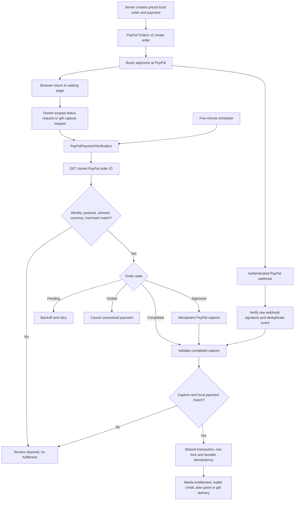

# Payment verification and reconciliation

## Scope and findings

Scemory has one external payment gateway: **PayPal Orders v2**. Its other monetary path is the internal Scemory wallet. The PayPal integration uses `srmklive/paypal` through `PayPalGateway`; server credentials and the merchant identifier come from `config/paypal.php`. There is no Stripe, card processor, or recurring PayPal billing subscription in the inspected application. A “plan subscription” is a one-time PayPal CAPTURE order that grants plan credits and updates the local subscription record.

Webhook delivery and direct verification now converge on the existing settlement code. Authenticated status requests and the reconciliation command query PayPal for the *locally stored* PayPal order ID. The order and completed capture evidence must match the local user/order relationship, purpose, reference where supplied, amount in integer minor units, currency, and configured merchant. Missing required capture evidence remains unresolved for retry; an explicit mismatch requires review. Only a completed capture can grant access, credit a wallet, or activate a plan. Browser return URLs only navigate to waiting pages.

## Payment flow inventory

| Gateway | Payment flow | Webhook | Direct verification | Automatic reconciliation | Tested |
|---|---|---|---|---|---|
| PayPal | Cart checkout, single media, multiple media, collection | Checkout endpoint | Owner status API; Orders v2 lookup | Five-minute payment command | Yes, including recovery, mismatch and duplicate settlement |
| PayPal | Wallet top-up | Wallet endpoint | Owner status API; Orders v2 lookup | Five-minute payment command | Yes, including missed-webhook recovery and single credit |
| PayPal | One-time plan purchase and permanent media-credit grant | Checkout endpoint | Owner status API; Orders v2 lookup | Five-minute payment command | Yes, including metadata binding and one grant |
| PayPal | Virtual gifts | Checkout endpoint | Sender capture API; Orders v2 lookup plus capture details | Pending payment command; settled gift capture checked daily | Yes, including refunded-before-webhook and voided order |
| Internal wallet | Media/cart purchase | Not applicable | Atomic internal ledger only | Not applicable | Yes, existing wallet purchase suite |
| Internal wallet | Plan purchase and credit grant | Not applicable | Atomic internal ledger only | Not applicable | Yes, existing plan suite |
| Internal wallet | Virtual gift and gift refund | Not applicable | Atomic internal ledger only | Gift earning release is separately scheduled | Yes, existing gift suite |
| Internal wallet | Media-credit redemption | Not applicable | Atomic credit-grant and redemption records | Not applicable | Yes, existing plan quota suite |

No mixed wallet/PayPal split payment path was found. Plan renewals are separate local purchases; no PayPal subscription invoice API is used. The internal wallet is not queried through PayPal.

Primary entry points: `routes/api.php:437-451,496-518`, `routes/gifts.php:12-28`; `app/Http/Controllers/api/payment/PaymentController.php:33-124`; `app/Http/Controllers/api/payment/DepositController.php:24-91`; `app/Http/Controllers/api/home/PlanSubscriptionController.php:37-224`; `app/Http/Controllers/api/gifts/GiftController.php:46-81`. Frontend consumers are `resources/js/services/PaymentService/PaymentService.js`, `resources/js/services/PaymentService/pollOrderStatus.js`, `resources/js/views/home/Waiting.vue`, `WaitingDeposit.vue`, and `VirtualGifts.vue`.

## Gateway API and provider states

`PayPalGateway::showOrderDetails()` calls the installed SDK's Orders v2 order lookup for the persisted `payments.paypal_order_id`; `capturePaymentOrder()` uses a stable `PayPal-Request-Id` when an approved order needs capture (`app/Services/PayPalGateway.php:40-59`). The supported provider endpoints are [GET `/v2/checkout/orders/{id}`](https://developer.paypal.com/docs/api/orders/v2/#orders_get), [POST `/v2/checkout/orders/{id}/capture`](https://developer.paypal.com/docs/api/orders/v2/#orders_capture), [GET `/v2/payments/captures/{id}`](https://developer.paypal.com/docs/api/payments/v2/#captures_get), and [GET `/v2/payments/refunds/{id}`](https://developer.paypal.com/docs/api/payments/v2/#refunds_get). PayPal's [Orders v2 integration guide](https://developer.paypal.com/api/rest/integration/orders-api/) and [capture status definitions](https://developer.paypal.com/api/payments/v2/definitions/capture_status/) govern state handling.

| PayPal order/capture evidence | Local action |
|---|---|
| `CREATED`, `SAVED`, `PAYER_ACTION_REQUIRED` | Remain unresolved; retry on schedule. |
| `APPROVED` | Submit capture with stable request ID; do not settle unless the returned capture is `COMPLETED`. |
| `COMPLETED` order with `COMPLETED` matching capture | Run the operation's existing finalizer once. |
| `VOIDED` order | Cancel the local unresolved payment and order; gifts also update gift state. |
| `PENDING` capture | Remain unresolved; do not grant financial effects. |
| `REFUNDED`, `PARTIALLY_REFUNDED`, `REVERSED` capture before ordinary settlement | Block fulfillment and flag payment for review. Gifts use their existing documented reversal path. |
| Unknown or inconsistent state/identity | Block settlement and flag review. |
| Timeout, rate limit, or incomplete provider evidence | Keep unresolved, back off, retry up to the configured hard limit. Provider authentication and local configuration failures require review. |

The lookup uses server-side PayPal credentials and fixed configured API hosts, never a browser-provided URL or token. `PAYPAL_MODE` selects sandbox or live; the corresponding server-side client ID/secret obtain access tokens. TLS validation is configured by `PAYPAL_VALIDATE_SSL`, which must remain enabled in production. API URLs, timeout, and retry settings are in `config/paypal.php:8-46`; no new environment variable was introduced. The only explicit direct REST refund request remains in `PayPalGateway::refundCapture()` (`app/Services/PayPalGateway.php:24-38`).

## Confirmation and settlement flow

1. Checkout snapshots server prices and creates a local `purchases` row and `payments` row before PayPal order creation. The PayPal order ID, custom ID and reference are stored locally (`CheckoutCartSnapshot::create`, `WalletDepositOrderService::create`, `VirtualGiftService::create`, and `PlanSubscriptionController::subscribePayPal`). A user cannot supply a replacement provider transaction ID to verification.
2. PayPal redirects the browser back to `/paypal/success`, `/wallet/success`, or `/gifts/paypal/return`. These callbacks do not mark payment complete. The ordinary and wallet callbacks redirect to waiting pages. The gift page calls the sender-owned capture endpoint. Ordinary and wallet waiting pages poll their authenticated owner-scoped status route for a bounded 30 attempts over roughly 150 seconds.
3. Status requests call `PayPalPaymentVerification::verify()` after owner and order-type checks. A short database lease prevents overlapping direct lookups for the same unresolved payment. PayPal order identity, single purchase unit, local order owner, amount, currency, custom/reference IDs, and merchant evidence are checked before passing evidence to existing `reconcile()` methods. `PaymentFinancialValidator::assertCompletedCapture()` then requires a matching completed capture ID, amount, currency, purpose, PayPal order, and configured merchant before any financial effect (`app/Services/PaymentFinancialValidator.php`).
4. Webhook processing still verifies the raw-body PayPal signature, records event IDs, and invokes the same finalizers. Direct verification, a late webhook, and a scheduler retry all meet at `PaymentFinalizer` or `VirtualGiftService::finalize`. Neither a browser redirect nor an `APPROVED` order is proof of a paid capture.

Relevant implementation: `app/Services/PayPalPaymentVerification.php:26-206`, `app/Services/PayPalServices.php:99-128,167-229,324-355`, `app/Services/PayPalWalletServices.php:87-104`, `app/Services/PaymentFinalizer.php:37-185`, `app/Services/VirtualGiftService.php:90-169`.

## Webhooks and security

The checkout and wallet webhook endpoints remain separate. `PayPalWebhookProcessor::process()` reads the original request body, checks event identity and the configured webhook ID, calls `PayPalWebhookVerifier`, and stores the event with a unique `(event_id, webhook_type)` key (`app/Services/PayPalWebhookProcessor.php:36-175`, `database/migrations/2026_07_18_000001_create_paypal_webhook_events_table.php:11-20`). The verifier checks required headers, allowed HTTPS PayPal certificate host, RSA/SHA-256 signature over the original body CRC32, and transmission data (`app/Services/PayPalWebhookVerifier.php:26-114`). Local/test bypass requires both verification disabled and the explicit local bypass flag; production must keep `PAYPAL_VERIFY_WEBHOOKS=true` and `PAYPAL_ALLOW_LOCAL_WEBHOOK_BYPASS=false` (`app/Services/PayPalWebhookProcessor.php:173-180`). PayPal's [webhook verification guide](https://developer.paypal.com/api/rest/webhooks/rest/) is the provider reference.

Owner status routes require Sanctum and a 60/minute throttle. The gift capture route requires Sanctum, the gift sender identity, and a 45/minute group throttle. Payment creation also has route throttles (`routes/api.php:496-518`, `routes/gifts.php:14-28`). Verification never takes a provider ID, amount, merchant, endpoint, or beneficiary from request input. Log entries for verification include only internal payment ID, provider order reference, trigger, attempt, result/category and exception class, not access tokens or full provider responses (`PayPalPaymentVerification::verify`).

`PayPalReversalReview::flag()` (`app/Services/PayPalReversalReview.php:14-47`) handles signed refund, reversal and dispute events for settled non-gift PayPal payments. It requires the event capture ID to equal the stored capture ID, then marks `verification_review_required` and `reversal_review`. It does **not** claw back wallet funds, creator earnings, credits, or media access because no approved policy exists for those operations. Gift refunds/disputes retain the established `GiftEarningsService` reversal, recovery and release freeze rules (`app/Services/PayPalServices.php:167-229,357-433`; `app/Services/GiftEarningsService.php:51-114`).

## Exactly-once financial effects

`PaymentFinalizer` locks payment and purchase rows in one database transaction. A completed payment returns without reapplying effects. The purchase finalizer creates unique `(user_id, media_id)` entitlements, credits sellers via `WalletLedgerService`, marks payment/order complete, and queues the receipt after commit. Wallet top-ups use a unique `wallet-credit:{payment_id}` ledger key; wallet-funded purchases use `wallet-debit:{payment_id}`. Plan captures create one credit grant and local subscription update inside the payment transaction. Gifts lock their own rows and use unique payment, capture, gift audit and earning references. The database has unique PayPal order ID, capture ID, PayPal request ID, payment idempotency key, wallet ledger idempotency key and entitlement constraints (`database/migrations/2026_07_19_000001_create_payment_hardening_tables.php:13-54`, `database/migrations/2026_07_19_000002_harden_existing_payment_tables.php:136-198`, `database/migrations/2026_10_18_000001_create_virtual_gift_tables.php:25-98`).

`WalletLedgerService::post()` performs integer minor-unit arithmetic and writes the balance and ledger together (`app/Services/WalletLedgerService.php:15-75`). Wallet-only purchases and gifts use that same ledger without attempting an external gateway lookup. Media credits are grants from a paid plan; redemption debits the grant in a transaction (`app/Services/PlanQuotaService.php:98-180,284-365`).

## Scheduling, retries, and operational review

`payments:reconcile --limit=100 --age=10` runs every five minutes with `withoutOverlapping(10)` (`routes/console.php:11-13`). It selects at most 100 PayPal payments older than ten minutes, including unresolved purchases, wallet deposits, plans and gifts. It also checks already paid gifts daily for capture fee/refund changes. `PayPalPaymentVerification` stores a 90-second lease, attempt count, last verification time, next due time, error category and review flag. A successful settlement stops ordinary payment polling. Transient provider failures and incomplete evidence retry with delays of 30, 60, 120 seconds, doubling to a one-hour cap. The sixth unsuccessful attempt flags review. Configuration failures and explicit identity/financial mismatches flag review immediately. A webhook may still settle a payment after direct verification is exhausted.

The new migration only adds nullable/defaulted columns and one due-work index to `payments`: `database/migrations/2026_10_24_000001_add_payment_verification_tracking.php`. It has no data backfill. Its `down()` intentionally preserves financial verification history; rolling it back does not remove columns. Coordinate any schema removal separately rather than dropping audit fields during an emergency rollback.

Automatic reconciliation **requires** a running Laravel scheduler and a working database/cache-lock connection in the deployed environment. The source also schedules `queue:work` every 30 seconds for existing asynchronous work (`routes/console.php:17-20`), though the reconciliation command itself runs as a scheduled command. On this WSL checkout, `php artisan schedule:list` could not connect to its configured MySQL cache-lock driver, so live scheduler execution was not verified. No production migration, live provider call, or deployment was performed.

Operators should review `payments` with `verification_review_required=1`, `verification_error_category`, `verification_attempts`, `last_verification_at`, and the corresponding PayPal order/capture reference; then check authenticated provider records before any manual accounting change. `paypal_webhook_events` records duplicate or failed events. Do not reset attempt counts or reassign provider IDs without a documented review procedure.

## Verification and test results

- `php artisan test`: **424 passed, 9 skipped, 3156 assertions** on SQLite in-memory test configuration.
- Opt-in MySQL concurrency tests verified against isolated disposable MySQL containers:
  - `tests/run-weekly-mysql-concurrency.sh`: **2 passed, 57 assertions**.
  - `tests/run-gifts-mysql-concurrency.sh`: **7 passed, 173 assertions** (including concurrent media finalization, competing media orders, duplicate wallet purchases, release/refund concurrency, verified capture callbacks, and concurrent withdrawals).
  - Total MySQL concurrency verification: **9 passed, 230 assertions**.
- `tests/Feature/Api/Payments/PayPalPaymentVerificationTest.php`: missing-webhook purchase/wallet recovery, plan payment metadata and credits, approved versus captured, identity/financial mismatches, timeout/rate-limit-shaped errors, retry limit, cancellation, repeat verification and ownership checks.
- `tests/Feature/Api/Payments/VirtualGiftsTest.php`: direct gift verification, refund-before-webhook, voided order and existing gift reversal tests.
- `tests/Feature/Api/Payments/PayPalWebhookTest.php` and `tests/Unit/PayPalWebhookVerifierTest.php`: signature, replay, capture mismatch, duplicate settlement and reversal-review behavior.
- `npm run build`: **passed**, with existing Sass deprecation and bundle-size warnings.
- `npm test -- --silent --reporter=dot`: **26 files, 238 tests passed**.
- `git diff --check`: passed. No production database records or environment files were changed.

## Known limits and deployment checklist

1. Apply the additive migration in the intended environment using the normal reviewed release process. Confirm the production scheduler and cache lock work, then watch due pending payments and PayPal API volume. Do not run the migration automatically as part of this code review.
2. Confirm the existing `PAYPAL_MODE`, sandbox/live credentials, `PAYPAL_MERCHANT_ID`, both webhook IDs, TLS verification, and API timeout settings are present. No new secret or PayPal Cloud configuration is required. Verify production has valid `APP_URL` and frontend URL for browser return routing.
3. Verify the two webhooks deliver signed events and that the scheduler executes every minute; `withoutOverlapping` requires a functional shared cache lock across hosts. Keep rate limits enabled on owner status and gift capture routes.
4. Exercise a sandbox purchase, wallet top-up, plan purchase and gift end-to-end, including a delayed webhook, before a production rollout. Run the opt-in MySQL concurrency suite in an isolated nonproduction database; SQLite cannot prove row-lock behavior under competing workers.
5. Review any existing unresolved historical PayPal payments before enabling reconciliation. Records with missing PayPal order IDs or inconsistent historic metadata cannot be safely auto-settled and need manual investigation.
6. Define and implement an approved non-gift refund/chargeback accounting policy before attempting automatic clawbacks. Those verified events are flagged for review; missed reversal webhooks for ordinary payments are not currently found by post-settlement capture polling. Gifts already have a daily settled-capture check.
7. The direct verification path has no separate administrator retry endpoint. A review flag is deliberately a stop signal requiring controlled operator intervention. There is no new frontend translation string; existing waiting pages retain bounded polling and their current wording.
8. Separate paid plan renewals continue to use the existing local subscription `updateOrCreate` rule, which resets the end date to one month from the newest payment. Decide and test a renewal-extension policy separately before changing that accounting rule.

To roll back application behavior, revert the application code through the normal release mechanism while retaining the additive verification fields and financial audit history. Leave all payment and ledger rows untouched. If provider availability falls, direct verification returns an unresolved response and the scheduled process backs off; webhooks remain independent.
