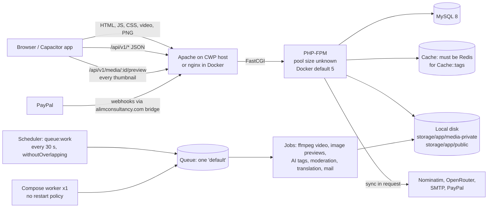

# Scemory — Production Capacity & Scalability Audit

**Date:** 26 October 2026
**Scope:** the whole repository at `C:\xampp\htdocs\Scene_memory`, as of commit `c455e76` (26 Oct 2026, "edit map colors"): the Laravel 12 API, Vue 3/Vite frontend, MySQL schema, queues and jobs, caching, Docker files, media storage, MapLibre, PayPal and webhooks. That commit includes the plan-optimizer and PayPal plan-checkout changes of 25–26 October.
**Type:** read-only static audit plus local measurements. **No code, database, configuration or dependency was changed.** No production system was contacted or load-tested.

---

## How to read this report

Every number in this report is tagged with where it came from:

| Tag | Meaning |
|---|---|
| **[M]** | **Measured** locally in this audit: the production build, file sizes on disk, or SQL statements counted by an in-memory SQLite probe. These are real measurements, but not of production. |
| **[C]** | **Code-derived.** Read from the source code and counted by hand, with no execution. |
| **[A]** | **Assumption.** A planning value chosen to make an estimate possible. Every [A] must be replaced by a load-test or production measurement before any decision rests on it. |
| ✓ | The file and line reference was opened again and confirmed while writing this report. References without ✓ come from systematic static reading of the code, not from running it. |

Confidence levels: **High** means the code or a measurement fixes it. **Medium** means it follows from the code plus standard framework behaviour. **Low** means it depends on unknown production settings.

---

## 1. Executive summary and verdict

### Verdict: **NOT READY for open production traffic.**
After the Critical fixes in §7, Scemory is suitable for a **small, monitored soft launch** (tens of concurrent users). Without them, the first public spike will most likely fail in one of these ways:

1. **The home page is too heavy.** It autoplays an **88.66 MB video [M]** with `preload="auto"` and loads **21.3 MB of PNGs [M]**. One new visitor can cost more than 100 MB of server bandwidth. On a 1 Gbit/s uplink that is about **one new home-page visitor per second [C/A]**, before anything else is counted.
2. **Every image goes through PHP at full resolution and is never cached.** Previews are original-resolution, watermarked JPEGs streamed by PHP-FPM with `Cache-Control: no-store` ✓ (`app/Http/Controllers/api/home/MediaDeliveryController.php:17,24`). No thumbnails exist anywhere. A browse page costs one PHP request per image, and CDNs and browsers cannot cache any of them.
3. **The rate limiter blocks normal users.** All numeric `throttle:N,1` limits share **one counter per IP (guests) or per user** across all routes ✓ (`vendor/laravel/framework/src/Illuminate/Routing/Middleware/ThrottleRequests.php:222-228`). One home view is about 20–30 counted requests **[C]**. The consequences:
   - a guest who browses for a minute can be locked out of **login (6/min)**;
   - everyone behind one mobile-carrier or office NAT shares a 90–120 requests/min budget;
   - an event page with more than about 80 comments throttles its own viewer, because it makes one gift-summary request per comment.
4. **Queries grow with the data, not with the request.**
   - Opening an event costs **N + 4 queries for N images, even on a cache hit [M]** (200 images → 204 statements).
   - Listing 8 events loads **every image of every listed event** **[M]** (8 × 40 images → 320 rows to show 8 thumbnails).
   - `is_active`, `start_date` and coordinates are `VARCHAR` ✓, so the existing indexes are probably unusable for the main filters (not yet confirmed with EXPLAIN).
   - Discovery search computes window functions over the whole catalogue twice per request ✓.
5. **The cache layer only works on Redis.** 26 controllers (34 files under `app/`) call `Cache::tags(...)` ✓, most with no fallback. That throws on the `database` and `file` stores, which is what `.env.example` ✓ and `config/cache.php:12` ✓ default to. **The production cache store could not be checked.** If it is not Redis or Memcached, many pages return HTTP 500 today.
6. **Background processing has no real capacity.**
   - There is effectively **one** queue worker for everything: video transcoding, AI tagging, moderation, translations and mail. The compose worker has no restart policy, and the scheduled fallback is guarded by `withoutOverlapping()` ✓.
   - Dashboard and media-request uploads process images **inside the HTTP request** ✓ (`app/Services/EventMediaIngest.php:22`).

### Headline capacity estimates (explicit assumptions in §4)

| Metric | Today (as coded, unknown server) | After Critical fixes, single 4 vCPU / 8 GB server | Confidence |
|---|---|---|---|
| Concurrent active users at peak | **~20–80** | ~200–500 | Low (server specs unknown) |
| Sustained API requests/s (warm cache) | ~15–50 | ~100–250 | Low |
| Daily active users (10% peak concurrency) | ~200–800 | ~2,000–5,000 | Low |
| New home-page visitors/s at 1 Gbit/s egress | **≈ 1 (bandwidth-bound)** | ≥ 20–40 (if the page is under 3–5 MB) | Medium (asset sizes are measured; uplink assumed) |
| Media jobs processed in parallel | **1** | 2–4 (separate queues) | High (from code) |
| Users sharing one NAT IP before 429s | ~1–3 browsing actively | Unlimited once limits are keyed per route and account | High (from code) |

These are **planning estimates, not benchmark results.** §9 sets out the k6 plan that replaces them with measurements.

---

## 2. What was inspected, measured, and could not be accessed

### Inspected
- **Backend:** all 271 routes (264 under `api/`), controllers, repositories, services, jobs, middleware, models and 100+ migrations.
- **Config:** `config/*.php`, `bootstrap/app.php`, `routes/console.php` (scheduler).
- **Containers and server:** `Dockerfile`, `docker-compose.yml`, `docker/nginx/default.conf`, `uploads.ini`, `entrypoint.sh`.
- **Frontend:** `resources/js` (app entry, router, views, services, i18n modules), `resources/views/index.blade.php`, `vite.config.js`, `vite.mobile.config.js`, `mobile/`.
- **Docs:** `docs/PAYPAL_WEBHOOK_BRIDGE.md`, `docs/security-media-marketplace-audit.md`, and the other files in `docs/`.

### Measured locally [M]
| Measurement | How |
|---|---|
| Production JS/CSS sizes | `npm run build` on 26 Oct, after `npm ci` aligned `node_modules` with `package-lock.json` |
| Static asset weight | `stat` on `public/video`, `public/images` |
| SQL statements per request | A PHPUnit probe run from a scratch directory outside the repo, using in-memory SQLite, synthetic rows and a Redis-like serialising cache (Appendix A.3) |
| Test-suite health | PHPUnit: 473 tests; 26 pre-existing environment failures (OpenSSL CSR signing, missing ffmpeg, Windows symlinks, one Google auth test). Vitest: 260 pass, 7 pre-existing RTL footer failures. |

### Not accessible: must be collected from the server (commands in Appendix C)
- The production host. `docs/PAYPAL_WEBHOOK_BRIDGE.md` describes a **CWP-managed Apache HTTPS server** that also runs the PayPal webhook bridge. Its CPU, RAM, disk type and free space, network uplink and monthly transfer quota are unknown.
- The production `.env`: `APP_DEBUG`, `CACHE_STORE`, `QUEUE_CONNECTION`, `SESSION_DRIVER`, `LOG_LEVEL`, `DB_*`, `FILESYSTEM_DISK`. No `.env` exists in the repo.
- The PHP-FPM pool (`pm`, `pm.max_children`, `pm.max_requests`), the **OPcache** status, the Apache MPM and its FastCGI buffering and timeouts.
- MySQL: version, `innodb_buffer_pool_size`, `max_connections`, slow-query log, table sizes, real EXPLAIN plans.
- Whether Redis, a CDN, cron/scheduler or supervisor workers run in production.
- Real traffic, error rates and logs.

### This workstation (not representative of production)
Intel i7-4710MQ (4 cores / 8 threads), 15.9 GB RAM, Windows 10, XAMPP PHP 8.3 CLI. MySQL is installed, but there is no Scemory database, and mbstring is disabled in `php.ini`. **No timing measured here should be used for production sizing**, so none are quoted.

---

## 3. Deployed architecture (as far as the repository shows)



Key facts:
- **Docker image:** `php:8.2-fpm` ✓ (`Dockerfile:1`). Extensions are installed at `Dockerfile:27-38` ✓ and **do not include `opcache`**. The FPM pool config is never overridden, so the image default (`pm.max_children = 5`) applies when this image is used.
- **Compose is a development stack.** It has `APP_DEBUG: true` ✓ (`docker-compose.yml:14,83`), phpMyAdmin published on port 8080 with root credentials ✓ (`:96-105`), and the Vite dev server. Do not use it as production.
- **nginx (Docker):** `client_max_body_size 50M` ✓ (`docker/nginx/default.conf:7`), with no `fastcgi_read_timeout`, so the 60 s default applies. PHP allows 100 MB uploads, 300 s and 256 MB memory ✓ (`uploads.ini:1-4`).
- **Media** is stored on **local disk**: `media` → `storage/app/media-private` ✓ and `public` → `storage/app/public` ✓ (`config/filesystems.php:32-50`). No S3 adapter is installed.
- **Scheduler** ✓ (`routes/console.php:11,15,17,22`): payment reconciliation every 5 min, gift earnings release hourly, the weekly leaderboard archive, and a `queue:work --stop-when-empty` run every 30 s.

---

## 4. Capacity model and estimates

### 4.1 Method
Each subsystem has an independent ceiling. Real capacity is the **lowest** one:

1. **Network egress:** bytes per page view against the uplink.
2. **PHP-FPM:** worker count ÷ mean worker-seconds per request.
3. **Rate limiter:** counted requests per page against per-IP and per-user budgets.
4. **Database:** statements and rows per request. This grows with data volume.
5. **Background processing:** job concurrency against upload rate.
6. **Third-party limits:** Nominatim, the unofficial Google Translate endpoint, OpenRouter, PayPal.

### 4.2 Inputs

| # | Input | Value | Source | Confidence |
|---|---|---|---|---|
| I1 | Home-page video | 88,658,828 bytes, `autoplay loop preload="auto"` | [M] `public/video/Final_Scemory.mp4`; `WeeklyLeaderboardPreview.vue:10,14,139` ✓ | High |
| I2 | Home-page PNGs | 6.35 + 7.63 + 7.29 MB = 21.27 MB, not lazy-loaded | [M] `public/images/photo1-3.png`; `ScemoryExperienceTabs.vue:42,100,122,144` | High |
| I3 | App JS entry | 2,185.95 kB raw / 712.34 kB gzip | [M] build `app-BLxHcJjK.js` | High |
| I4 | MapLibre (loaded on every home visit) | 988.10 / 258.61 kB gzip + worker 471.37 kB raw | [M] build | High |
| I5 | CSS on the entry | 556.39 kB + 147.35 kB duplicate Tailwind (78.9 + 21.3 kB gzip) | [M] build | High |
| I6 | API calls per guest home view | ≈ 10–14 | [C] `home.vue` mount flow (profile, categories, countries, trending, tags, discovery search, plans, daily map events, leaderboard, special coverage, footer) | Medium |
| I7 | PHP-served images per home view | ≈ 8–16 previews (8 discovery cards + trending + other sections), each full resolution | [C] | Medium |
| I8 | PHP requests per home view | **≈ 20–30** (I6 + I7) | [C] | Medium |
| I9 | FPM workers W | 5 (Docker default); production unknown | [C] / unknown | Low |
| I10 | Mean worker time per warm API request S | **0.1 s** planning value; **2–3×** that without OPcache | [A] | Low |
| I11 | Think time between page views | 45 s | [A] | Low |
| I12 | Peak concurrency | 10% of DAU online at the peak hour | [A] | Low |
| I13 | Uplink | 1 Gbit/s ≈ 125 MB/s (also shown for 100 Mbit/s) | [A] | Low |

### 4.3 Ceiling 1: network egress (the most likely first failure)

A new visitor's home view in the worst case, where the video downloads fully (likely, because autoplay, loop and `preload="auto"` are all set):

| Item | Bytes |
|---|---|
| Video (I1) | 88.66 MB |
| PNGs (I2) | 21.27 MB |
| JS (gzip): app + MapLibre + worker | ≈ 1.1 MB |
| CSS (gzip), icon fonts, CDN extras | ≈ 0.5 MB |
| Full-resolution previews (I7) | 8–16 × unknown size (not cacheable) |
| **Total (excluding previews)** | **≈ 111 MB** |

Throughput:
- 125 MB/s ÷ 111 MB ≈ **1.1 new home visitors per second** at 1 Gbit/s.
- At 100 Mbit/s: ≈ **0.11 per second**, about one every 9 s.
- 10,000 new home visits a day ≈ **1.1 TB/day** of egress.
- Static files can be cached by returning browsers if Apache sends cache headers (unknown). Previews never can: they are `no-store` ✓.

Confidence: High for bytes per view; Low for the uplink.

### 4.4 Ceiling 2: PHP-FPM workers

Formulas:
- Requests per second (RPS) ≈ W ÷ S.
- Page views per second (PV/s) ≈ RPS ÷ I8.
- Concurrent users ≈ PV/s × think time.

| W (workers) | S (s) | RPS | Home views/s (25 req each) | Concurrent users (45 s think) |
|---|---|---|---|---|
| 5 (Docker default) | 0.1 | 50 | 2.0 | ~90 |
| 5, no OPcache | 0.25 | 20 | 0.8 | ~36 |
| 20 | 0.1 | 200 | 8 | ~360 |
| 40 (needs ~4 GB RAM for workers [A]) | 0.1 | 400 | 16 | ~720 |

This table is the *best case*, with a warm cache and short requests. It is reduced by:
- **Image previews.** PHP reads and copies every byte of full-resolution files ✓ (`MediaDeliveryController.php:17,24`). Whether a worker is also held for the client's whole download depends on web-server buffering: nginx buffers FastCGI responses by default; Apache's `mod_proxy_fcgi` must be checked on the CWP host.
- **Synchronous image processing in uploads** ✓ (`EventMediaIngest.php:22`). This is seconds per image, times up to 8 images per request, and can run past the 60 s proxy timeout.
- **Cache misses on media-heavy events.** These cost N + 10 queries [M].
- **Requests that wait on third parties:** Nominatim (up to 2 × 10 s), OpenRouter (up to 70 s in `/v1/tools/image-tags`), SMTP sends.

Applying those reductions gives the "~20–80 concurrent users" in §1. Confidence: Low.

### 4.5 Ceiling 3: rate limits (per IP for guests, per account for signed-in users)

- **Shared counter.** `throttle:90,1` (events, comments, tags, gifts), `throttle:120,1` (previews ✓ `routes/api.php:173-174`), `throttle:6,1` (login) and the rest all use **the same cache key** for a given IP or user ✓.
- **Guests.** One guest home view (I8 ≈ 20–30 hits) followed by an event page can exceed **6 hits in the last minute**, so login returns 429. Three or four page views a minute exhaust the 90/min budget **[C]**.
- **NAT.** Mobile-carrier CGNAT, campuses and offices put many users on one IP and therefore one budget **[C]**.
- **Large events.** The single-event page makes **1 + C** gift-summary requests for C comments (`single_event.vue:430`, `GiftSupportButton.vue:19`). Above about 80 comments, it throttles itself **[C]**.
- **Unthrottled routes.** Plan checkout, credit redemption, withdrawals, the upload endpoints, both webhooks and `subscribe/{id}` have no limit at all. That is an abuse surface, not a capacity limit.

Confidence: High (code plus framework source).

### 4.6 Ceiling 4: database (grows with data)

Measured statements per request (SQLite probe, Appendix A.3; counts carry over to MySQL, timings do not):

| Scenario | Statements [M] |
|---|---|
| Single event, 5 images, cache miss / hit | 15 / 9 |
| Single event, 50 images, miss / hit | 60 / 54 |
| Single event, 200 images, miss / hit | 210 / **204** |
| Home list, 8 events × 40 images, miss | 12 statements, **320 image rows** loaded to show 8 |

Code-derived costs that scale with the size of the catalogue:
- Discovery search runs `ROW_NUMBER() OVER (...)` over every active event, image and video, twice (count plus page) ✓ (`EventRepository.php:514,531`). It uses a random seed per request ✓ (`DiscoverySearchRequest.php:122`), so results can never be cached.
- The map/radius endpoints scan every event with `CAST`/`ST_Distance_Sphere` on `VARCHAR` coordinates (`EventController.php:701-723`).
- `/events/daily` returns every matching event with `->get()` ✓ (`EventRepository.php:870-880`).
- The profile timeline costs ~60–90 statements; the weekly leaderboard is a full sort per call.

So database capacity has no fixed number. It **falls as the catalogue grows**. Confidence: Medium (no EXPLAIN on real data).

### 4.7 Ceiling 5: background processing

**Concurrency is 1.**
- The compose `worker` service ✓ (`docker-compose.yml:73-89`) has no `restart:`.
- The scheduled worker ✓ (`routes/console.php:17`) is `withoutOverlapping()`.
- Everything uses the `default` queue.

**Per uploaded video [C]:**
- 1 full-resolution, full-length x264 encode (300 s cap, up to 3 attempts, no backoff);
- plus, for each AI-tag run, 1 ffprobe, up to 5 ffmpeg frame grabs and 1 OpenRouter call;
- **AI tagging is re-run for the whole event on every upload.**

**Per image [C]:** an Intervention decode, a second GD decode, blur, watermark and full-resolution JPEG encode. Up to 40 MP is allowed ✓ (`config/media_security.php:4`), against a 256 MB memory limit.

**Translation fan-out [C]:** up to 8 + 10 × 5 tags per event, each causing 13 sequential calls to the unofficial Google Translate endpoint with **no timeout**.

One long video blocks moderation, receipts and translations for everyone. Confidence: High.

### 4.8 Ceiling 6: third parties
- **Nominatim** has a public usage policy of about 1 request per second. It is called synchronously from an unauthenticated POST (`EventController.php:529-637`) and from the browser on every map click (`MapService.js:434-439`). Expect throttling or blocking at modest traffic.
- **The Google Translate scraping endpoint** (`TranslateTagJob.php:41-45`) is unofficial. It can be rate-limited or blocked without notice.
- **PayPal:** every SDK call creates a new client and fetches a new OAuth token (`PayPalGateway.php`, `client()`), and the SDK's Guzzle client has no timeout.

### 4.9 Summary of capacity

| Metric | Estimate today | Dominant limit | Confidence |
|---|---|---|---|
| Concurrent active users | ~20–80 | FPM with default pool, media through PHP, rate limiter | Low |
| Requests/s (API, warm cache) | ~15–50 | FPM workers (W = 5) | Low |
| DAU | ~200–800 | I12 applied to the line above | Low |
| Peak new-visitor arrival | ≈ 1/s per Gbit/s | Home-page weight | Medium |
| Uploads | ≈ 1 job at a time; uploads also block FPM | Queue concurrency, synchronous processing | High |
| Search and map | Degrades as the catalogue grows | Full scans, window functions | Medium |

---

## 5. Bottlenecks by layer (file and line evidence)

### 5.1 Web server and PHP runtime
| ID | Finding | Evidence |
|---|---|---|
| W1 | No OPcache in the image | `Dockerfile:27-38` ✓ (extension list) |
| W2 | FPM pool never sized, so the image default `pm.max_children=5` applies | No pool file copied; only `uploads.ini` (`Dockerfile`) ✓ |
| W3 | Upload limits disagree: nginx 50 MB, PHP 100 MB, validation 8 × ~20 MB, admin 50 MB per file | `docker/nginx/default.conf:7` ✓, `uploads.ini:1-2` ✓, `EventsRequest.php:42-47,155`, `EventImageController.php:46-47` |
| W4 | Proxy timeout 60 s (nginx default), PHP 300 s: clients get a 504 while PHP keeps working | `default.conf` (no `fastcgi_read_timeout`) ✓, `uploads.ini:3` ✓ |
| W5 | Global API middleware is cheap: SetLocale, BlockBadBots (UA substring), EnsureActiveAccount | `bootstrap/app.php:18-23` ✓ |
| W6 | Sanctum writes `last_used_at` on every authenticated request | `vendor/laravel/sanctum/src/Guard.php:167` |
| W7 | Logging goes to one file at `debug` level; the webhook path writes ~8 info lines per event | `.env.example:31,33` ✓; `PayPalWebhookProcessor.php:54-70` ✓ |

### 5.2 Media delivery and storage
| ID | Finding | Evidence |
|---|---|---|
| M1 | Every preview is streamed by PHP with `no-store` | `MediaDeliveryController.php:17,24` ✓ |
| M2 | No thumbnails: previews are original resolution (blur + watermark + JPEG 75) | `ImageAnalysisService.php:309-323`; `EventsImges.php:24-29` |
| M3 | Video previews are full-length, full-resolution re-encodes | `ProcessEventVideoJob.php:227-245` |
| M4 | No X-Sendfile / X-Accel-Redirect anywhere | repository-wide search |
| M5 | Timeline uses 5-minute signed URLs, so each response gets unique URLs that cannot be cached | `TimelineEventResource.php:28`, `MediaAccessService.php:89` |
| M6 | Search result videos use `preload="auto"` (up to 8 per page) | `DiscoveryResultsSection.vue:115-129` |
| M7 | Local disk only, which blocks horizontal scaling; a worker on another host silently drops media | `config/filesystems.php:32-50` ✓; `ProcessEventImageJob.php:76-83` |
| M8 | Purchased originals keep GPS EXIF (privacy) | `ProcessEventImageJob.php:122`, `EventMediaIngest.php:26` |
| M9 | Legacy public originals stay exposed until static URLs are blocked (previous audit) | `docs/security-media-marketplace-audit.md:9` ✓ |

### 5.3 Uploads, jobs and queues
| ID | Finding | Evidence |
|---|---|---|
| Q1 | Image processing inside HTTP requests (dashboard, media request, admin) | `EventMediaIngest.php:22` ✓; called from `UserDashboardController.php:54` ✓, `MediaRequestController.php:41` ✓, `EventImageController.php:52` ✓ |
| Q2 | One worker, one `default` queue, no restart | `docker-compose.yml:73-89` ✓; `routes/console.php:17` ✓ |
| Q3 | The AI job re-runs per upload, reprocesses every video, can exceed `$timeout=180`, and leaves overlap locks and frame directories behind | `GenerateEventAiTagsJob.php:26,47-49,87-91,199`; `EventMediaIngest.php:38,42`; `ProcessEventVideoJob.php:78,119` |
| Q4 | Translation fan-out with no HTTP timeout | `TagResolverService.php:33`; `TranslateTagJob.php:41-45` |
| Q5 | Video job: 3 attempts, no backoff; originals orphaned on failure | `ProcessEventVideoJob.php:23,90,245,275-278` |
| Q6 | Mail sent synchronously in requests (OTP, password reset, free subscribe) | `RegistrationOtpService.php:58`, `AuthController.php:297`, `IncomeController.php:51-52` |
| Q7 | No scheduler process in the containers; production cron is unverified | `entrypoint.sh` (php-fpm only) ✓; `docs/weekly-ranking.md:52` |

### 5.4 Database and queries
| ID | Finding | Evidence |
|---|---|---|
| D1 | N+1 per image on serialization, including cache hits (measured N + 4) | `EventsImges.php:18-30` ✓ → `MediaAccessService.php:16` ✓; single event loads all images `EventRepository.php:813` |
| D2 | `firstImage` is an unbounded `hasOne`; eager-loading it reads every image of every listed event (measured 320 rows for 8 events) | `Events.php:92-95` ✓ |
| D3 | `is_active`, `start_date`, lat/lng are VARCHAR; integer comparisons probably defeat the indexes | `create_events_table.php:23,27,28,30` ✓; `create_events_images_table.php:33` ✓ |
| D4 | Discovery: UNION ALL with 3 window functions over the whole catalogue, twice; random seed; `LIKE '%q%'` on LONGTEXT | `EventRepository.php:505-614` ✓ (514, 531) |
| D5 | Map and radius search: full scans, no LIMIT, inline Nominatim, writes on a public POST | `EventController.php:305-359,517-723` |
| D6 | `/events/daily` unbounded; the cache key has no date | `EventRepository.php:870-880` ✓ |
| D7 | Profile timeline ~60–90 queries | `ProfileRepository.php:79-91,187-192` |
| D8 | Weekly leaderboard: mixed-direction sort on every call, `whereHas('user')`, rank via COUNT | `WeeklyLeaderboardService.php:18,25,39-42,56` |
| D9 | Gift summary per comment (1 + C requests, uncached GROUP BY) | `GiftController.php:104-108`; `single_event.vue:430` |
| D10 | Relations loaded in full: city with all events, creator with all likes and views | `CityRepository.php:22`; `EventRepository.php:59,803-804,889` |
| D11 | Per-view writes: `EventViews::firstOrCreate`; profile GET may create a cart and wallet | `EventRepository.php:84`; `AuthController.php:236-241` |
| D12 | Missing indexes: listed in Appendix B | migrations |

### 5.5 Caching
| ID | Finding | Evidence |
|---|---|---|
| K1 | `Cache::tags` throws on the `database` and `file` stores; 26 controllers call it, most with no fallback ✓ | `config/cache.php:12` ✓; `.env.example:56` ✓; e.g. `EventController.php:66,77,92,307,398`, `CartController.php:28-29,92` |
| K2 | Invalidation storms: one comment flushes every comment cache; each processed image flushes the whole `events` tag | `CommentController.php:184`; `EventTagCacheService.php:57` via `ProcessEventImageJob.php:180` |
| K3 | A tagged flush on `['cart', "user_{id}"]` wipes every user's cart cache; the `user_profile` tag is flushed but never read | `CartController.php:28-29`, `WhisListController.php:52,71` |
| K4 | Cache keys missing locale or page; unbounded keys built from user search text | `CreatorController.php:42`, `EventController.php:61-64,305` |

### 5.6 Rate limiting
| ID | Finding | Evidence |
|---|---|---|
| R1 | All numeric throttles share one key per IP or user | `ThrottleRequests.php:222-228` ✓ |
| R2 | No `throttleApi()` and no named `RateLimiter::for` limiters | `bootstrap/app.php:18-23` ✓ |
| R3 | 25 unauthenticated routes are unthrottled; money-moving routes (plan checkout, redemption, withdrawals) are unthrottled | `php artisan route:list` (counted in this audit) [M]; `routes/api.php:444-455,537-543` |
| R4 | `BlockBadBots` rejects any User-Agent containing `curl`, `python-requests` or `scrapy` (it also blocks Locust's default client) | `app/Http/Middleware/BlockBadBots.php` ✓ |

### 5.7 Frontend
| ID | Finding | Evidence |
|---|---|---|
| F1 | 88.66 MB autoplay video and 21.27 MB PNGs on the home page | [M]; `WeeklyLeaderboardPreview.vue:10,14,139` ✓ |
| F2 | 2.19 MB app chunk; about 70% of it is the eagerly imported messages for all 13 locales | `resources/js/app.js:12-32,65-87`; build [M] |
| F3 | MapLibre (988 kB + 471 kB worker) loads on every home visit; DOM markers, no clustering; `/events/daily` unbounded | `MapSection.vue:122-132,163-164`; `MapService.js:198-256` |
| F4 | Render-blocking CDN assets: a synchronous toastr script, unused Alpine v2, Font Awesome for about 6 icons, duplicate bootstrap-icons | `resources/views/index.blade.php:39-48` ✓ |
| F5 | Duplicate and dead code: Bootstrap JS twice, jQuery (via toastr), animate.css, the Vue template compiler alias, Tailwind CSS loaded twice | `app.js:35-39`, `bootstrap.js:2`, `vite.config.js:26`, `index.blade.php:37` ✓ |
| F6 | The country page downloads a worldwide GeoJSON from GitHub each time its map is built, and uses tile.openstreetmap.org directly | `country_data.vue:637-667` |
| F7 | Repeated profile and credits fetches on every route change and focus | `Navbar.vue:588,599-600` |
| F8 | Small leaks: popup click handlers accumulate; the fullscreen map's WebGL context is not destroyed | `MapService.js:127-131,229-245` |
| F9 | The mobile shell loads `maplibre-gl@latest`, toastr, Alpine and fonts from CDNs at launch | `mobile/index.html:20-58` |

### 5.8 Payments, webhooks, financial concurrency
What holds up:
- webhook RSA verification runs before any database write;
- events are de-duplicated on a unique `(event_id, webhook_type)`;
- unique `capture_id`, `paypal_order_id` and `idempotency_key`;
- PayPal-Request-Id is sent on create and capture;
- amount, currency, merchant and custom-ID checks;
- PayPal calls are made outside database transactions;
- plan capture is re-validated before money is taken (since 26 Oct).

| ID | Finding | Evidence |
|---|---|---|
| P1 | Refunds and chargebacks are only flagged, never clawed back; withdrawals ignore the flag | `PayPalReversalReview.php:26-43`; `WithdrawalReservationService.php:60-80` |
| P2 | Webhook de-duplication is check-then-act; returns 200 "duplicate" while the first delivery is still processing (a later failure is lost until reconcile) | `PayPalWebhookProcessor.php:123-138` ✓ |
| P3 | Capture runs synchronously inside the webhook request (delivery timeouts) | `PayPalServices.php` (`approved()`, plan reconcile) ✓ |
| P4 | Late PENDING or DECLINED events can overwrite completed purchases and wallet top-ups (unlocked, stale read) | `PayPalServices.php` `pending()` / `declined()`; `PayPalWalletServices.php:149-171` |
| P5 | Lock-order inversions: gifts (gift then user versus user then gift), seller wallets locked in item order, ledger `SELECT … FOR UPDATE` on a missing key (gap-lock deadlocks on MySQL) | `VirtualGiftService.php:31,93-95,140`; `GiftEarningsService.php:75-76`; `PaymentFinalizer.php:160,211-245`; `WalletLedgerService.php:30-33` |
| P6 | Two concurrent plan purchases can both pass the pre-capture accumulation check; the second is captured and then refused at grant time | `PayPalServices.php` (`planCaptureBlocker`, no lock) ✓; `PlanQuotaService.php:141` |
| P7 | Wallet plan purchase has no client idempotency key, so a double submit debits twice | `PlanSubscriptionController.php:74` ✓ |
| P8 | Unique indexes may have been silently skipped during hardening; `user_credit_grants.purchase_id` is not unique; ledger rows cascade on delete | `2026_07_19_000002_harden_existing_payment_tables.php:180-198`; `2026_10_22_000007...:13-36` |
| P9 | SQLite tests cannot prove locking; the MySQL concurrency script needs Docker, which is not installed here | `phpunit.xml`; `tests/run-plans-mysql-concurrency.sh` |

### 5.9 Security risks relevant to going live
| ID | Finding | Evidence |
|---|---|---|
| S1 | Sanctum tokens never expire; tokens (admin included) live in `localStorage`; admin has no MFA | `config/sanctum.php:50` ✓; `authTokenStorage.js:58`; `admin/auth/login.vue:81` |
| S2 | 5xx bodies are hidden only when `APP_DEBUG=false`; `.env.example` sets it to true | `SecurityResponseHeaders.php:20` ✓; `.env.example:8` ✓ |
| S3 | No HSTS or CSP header; CORS falls back to `*` | `SecurityResponseHeaders.php`; `config/cors.php:8` |
| S4 | Reset and deletion codes go through `Mail::raw` with no log-mailer guard (`MAIL_MAILER=log` writes codes to logs); forgot-password reveals which emails exist | `AuthController.php:289,297`; `UserDataDeletionService.php:407` |
| S5 | Users submit their own withdrawal `fee` and payout references | `UserWithdrawlController.php:147-153` |
| S6 | A SQLite database file (`scene_memory`, 626,688 bytes) is tracked in git | `git ls-files` ✓ [M] |
| S7 | The Facebook data-deletion callback is a stub (compliance) | `UserDataDeletionController.php:178-186` |
| S8 | Dead routes return 500 (`HomeController::update/destroy` do not exist) | `routes/api.php:378-379` |

---

## 6. Scalability risks

| Risk | Trigger | What happens |
|---|---|---|
| Egress saturation | A marketing push or viral share | Home page stalls for everyone; bandwidth bill or quota exceeded |
| FPM exhaustion | Several thumbnail-heavy pages, plus uploads or slow third parties | Queueing, 502/504, then the whole site is slow |
| 429 storms | NAT'd audiences (mobile carriers, events, universities); big comment threads | Users locked out of login and browsing |
| Cache store mismatch | Production not on Redis | HTTP 500 on home, events, cart, comments, plans |
| Data growth | 10k+ events, 100k+ media | Discovery, map and list queries get slower on every request; DB CPU saturates |
| Cache invalidation storms | Batch uploads (100 photos) | 100+ full flushes; a cold cache under load |
| Queue head-of-line blocking | One long video, or a hung translation socket | Moderation, receipts and tagging stall for hours |
| Third-party bans | Nominatim policy, translate scraping | Geocoding and translation silently stop |
| Financial loss | Chargebacks after a top-up and withdrawal | Platform absorbs the loss |
| Deadlocks | Concurrent gifts or purchases between the same users | Retries, latency, occasional 500s |
| Single server | Any hardware or disk failure | Full outage; local media lost without backups |

---

## 7. Prioritised fixes

Effort: **S** < 1 day, **M** 1–5 days, **L** > 1 week. Impact figures are measured [M] or code-derived [C]; anything else is a target.

### Critical: before any public launch
| # | Fix | Files | Expected impact | Effort |
|---|---|---|---|---|
| C1 | **Fix the home-page weight.** Re-encode the hero video to a few MB at 720p with a poster, `preload="none"`, and play only when visible. Convert the PNGs to WebP/AVIF with `srcset` and `loading="lazy"`. Drop the unused CDN scripts. | `WeeklyLeaderboardPreview.vue`, `ScemoryExperienceTabs.vue`, `index.blade.php` | First-visit weight from **≈111 MB [M]** to a few MB. Raises the egress ceiling **~20–40×** [C] | S |
| C2 | **Real derivatives plus CDN delivery.** Generate 400/800/1600 px WebP previews and ≤720p capped video previews. Serve published previews as public, immutable, content-hashed files from object storage or a CDN (or X-Accel/X-Sendfile). Serve originals only through short-lived signed URLs. | `ImageAnalysisService.php`, `ProcessEventVideoJob.php`, `MediaDeliveryController.php`, `MediaAccessService.php`, frontend cards | Takes ~8–16 PHP requests out of every page view [C]. Thumbnail bytes drop by roughly an order of magnitude. Enables browser and CDN caching | M–L |
| C3 | **Use Redis for cache, locks and rate limits in production,** and fail on boot if the store cannot do tags. | `.env`, `AppServiceProvider` | Removes the 500 risk (K1). Shared locks and limits | S |
| C4 | **Rate limiting.** Named limiters keyed per route and per account (e.g. `login|ip|email`), `throttleApi()`, a separate generous budget for media, limits on money-moving routes. | `bootstrap/app.php`, `AppServiceProvider`, `routes/api.php` | Ends 429s for legitimate users and NAT groups; closes the abuse surface | S–M |
| C5 | **Fix the N+1 and the unbounded `firstImage`.** Use `chaperone()` or eager-load `images.events`; `oldestOfMany()` with an `is_active` filter; paginate event images. | `Events.php`, `EventsImges.php`, `MediaAccessService.php`, `EventRepository.php:813` | Single event from **N+4 → ~4–10 statements [M baseline]**; list image rows from Σ images to ≤ 8 [M] | S |
| C6 | **PHP runtime.** Enable OPcache (with `validate_timestamps=0` in production); size the FPM pool to RAM (start around 2 × vCPU to 4 × vCPU workers, measure RSS); `pm.max_requests`; FastCGI timeouts that match PHP limits; align upload limits across the layers. | Server config, `Dockerfile`, `docker/nginx/default.conf`, `uploads.ini` | Large drop in per-request CPU [A]; predictable worker capacity | S |
| C7 | **Asynchronous uploads and real workers.** Move dashboard, media-request and admin image processing to jobs (return 202). Run supervisor or Horizon with separate queues (`video`, `images`, `ai`, `translations`, `mail`/`default`), `--max-time`, restart policies. Remove the scheduled `queue:work`. | `EventMediaIngest.php`, controllers, `routes/console.php`, deployment | Uploads stop blocking FPM; media throughput scales with workers; no head-of-line blocking | M |
| C8 | **Production `.env` and server baseline.** `APP_DEBUG=false`; `LOG_STACK=daily`, `LOG_LEVEL=warning`; `config:cache` / `route:cache` / `event:cache`; scheduler cron; backups; HTTPS headers (HSTS). | server | Safe errors; bounded logs; faster boot | S |

### High: before scaling past a soft launch
| # | Fix | Files | Expected impact | Effort |
|---|---|---|---|---|
| H1 | Normalise column types (`is_active` TINYINT, `start_date` DATE, lat/lng DECIMAL or POINT SRID 4326 with a spatial index) and add the composite indexes in Appendix B | migrations, data migration | Index-backed listing and map queries; confirm with EXPLAIN | M |
| H2 | Replace live discovery with a precomputed `discovery_items` table, key-set pagination, `simplePaginate`, and FULLTEXT or Meilisearch for text | `EventRepository.php:505-614` | Removes full-catalogue work per search | M–L |
| H3 | Map endpoints: bbox and spatial index, LIMIT or clustering, cache per tile, move Nominatim to a queue with caching and a 1 req/s limiter; client-side GeoJSON clustering | `EventController.php`, `MapService.js`, `MapSection.vue` | Bounded map cost; Nominatim policy compliance | M |
| H4 | Per-entity cache keys or versioned tags; one invalidation per job batch | `CommentController.php`, `CartController.php`, `EventTagCacheService.php` | Ends flush storms | M |
| H5 | Batch gift summaries into the comments payload; cache the leaderboard for 30–60 s (or a Redis sorted set); add `(week_start, points DESC, user_id)` | `GiftController.php`, `WeeklyLeaderboardService.php` | Removes 1+C requests per event page; constant leaderboard cost | S–M |
| H6 | Lazy-load locale messages per language and namespace; precompile with `@intlify/unplugin-vue-i18n`; remove dead libraries; `manualChunks` for vendors | `app.js`, `vite.config.js` | App entry roughly −70% (messages are about 1.5 MB of the 2.19 MB chunk [M/approx.]) | M |
| H7 | Load the home map on interaction or when idle; GeoJSON source with `cluster: true`; cap `/events/daily` | `MapSection.vue`, `MapService.js`, `EventRepository.php:870` | −1.46 MB of JS per home visit [M] | S–M |
| H8 | AI and translation jobs: unique per event with debounce, per-media jobs, skip already-tagged media, 1024 px inputs, HTTP timeouts, dispatch translations only for new tags, batch locales via an official API | `GenerateEventAiTagsJob.php`, `TagResolverService.php`, `TranslateTagJob.php` | Removes hundreds of external calls per event [C] | M |
| H9 | Reversal handling: holds or negative ledger entries on refunds and chargebacks; block related withdrawals | `PayPalReversalReview.php`, `WithdrawalReservationService.php` | Stops chargeback losses | M |
| H10 | Token hygiene: Sanctum expiration plus `sanctum:prune-expired`, admin abilities, admin MFA | `config/sanctum.php`, auth controllers | Limits XSS blast radius | M |
| H11 | Atomic webhook claims (conditional update), 409/503 while processing, queued handlers | `PayPalWebhookProcessor.php`, `PayPalServices.php` | No lost events; fast acknowledgements | M |
| H12 | Object storage (S3-compatible) for media and `onOneServer()` for scheduled tasks | `config/filesystems.php`, `routes/console.php` | Enables more than one app server | M |

### Medium
- **Lock ordering.** Lock users and wallets in ascending ID order. Replace the ledger's locking read with insert-and-catch (P5).
- **Late events.** Lock and re-check before PENDING or DECLINED updates on purchases and wallet top-ups (P4).
- **Plan concurrency.** Serialise plan captures per user, for example with a user-row lock around the blocker check and capture (P6). Add a client idempotency key for wallet plan purchases (P7).
- **Database constraints.** Unique `user_credit_grants.purchase_id`; verify that the hardening unique indexes exist in production; `restrictOnDelete` on ledger foreign keys (P8).
- **Write reduction.** Throttle Sanctum `last_used_at` writes; buffer view counts in Redis; make the profile GET read-only (W6, D11).
- **Indexes and queries.** Comments `(event_id, created_at, id)` and interactions `(comment_id, type, deleted_at)`; `users.country`; plain `where('email')` instead of `LOWER(email)`.
- **Frontend fetching.** TTL cache for profile and credits; parallelise single-event loads; lazy-mount home sections below the fold; cache reference data; remove the 1 s `App.vue` delay; fix the map popup listener leak.
- **Privacy and account security.** Strip EXIF from sold originals or warn sellers; guard `Mail::raw` codes; make forgot-password non-enumerating; re-verify changed emails; compute withdrawal fees on the server.
- **Queue workers.** Raise video worker memory (`--memory=1024`); add backoff and cleanup in `failed()`.

### Low
- Remove redundant indexes; add locale and page to cache keys; remove unused Scout `Searchable`; remove the dead routes (S8).
- Remove the tracked SQLite file from git (S6). Remove the hard-coded personal email in `HomeController.php:52`.
- Mobile shell: bundle, don't fetch from CDNs. Favicon size; the external fallback image; `allowBackup` on Android.
- Remove unused npm packages: leaflet, vue-leaflet, leaflet-control-geocoder, sweetalert2, vue3-toastify.

---

## 8. Infrastructure recommendations by size

"Users" here means **daily active users**, assuming 10% are online at the peak hour [A].

Every tier assumes:
- **C1–C8 are done;**
- media is served from object storage behind a CDN;
- Redis is used for cache, queues, locks and rate limits;
- OPcache is on;
- backups and monitoring are in place: uptime, error tracking, PHP-FPM status, MySQL slow log, queue depth.

Sizes are **starting points to validate with §9**, not guarantees.

| | **100 DAU** (~10 concurrent) | **1,000 DAU** (~100 concurrent) | **10,000 DAU** (~1,000 concurrent) | **100,000 DAU** (~10,000 concurrent) |
|---|---|---|---|---|
| App / web | 1 VPS, 2–4 vCPU, 4–8 GB; Apache event MPM or nginx + PHP-FPM (10–16 workers) | 1 VPS, 4 vCPU, 8 GB (FPM 20–30 workers), or 2 small servers behind a load balancer | 2–4 app servers (4–8 vCPU, 8–16 GB each) behind a load balancer; stateless (S3 media, Redis sessions) | Autoscaling app tier (6–20+ instances); consider Octane/RoadRunner after profiling; blue-green deploys |
| Database | MySQL 8 on the same host (`innodb_buffer_pool_size` ≈ 50–60% of RAM if it has the host to itself) | Separate or managed MySQL, 2–4 vCPU, 8 GB; daily backups plus binlogs | Managed MySQL primary, 8 vCPU / 32 GB, plus 1–2 read replicas; pooled connections | Primary plus several replicas (or Aurora-class); partition heavy tables; dedicated reporting replica |
| Cache / queue | Redis on the host | Redis (1–2 GB) | Managed Redis with replica | Redis cluster; separate instances for cache and queues |
| Workers | 1 worker per queue (video at concurrency 1) | Horizon: video 1–2, images 2, ai 1–2, mail/default 2 | Dedicated worker hosts; autoscale video workers on queue depth | A transcoding service or GPU/CPU pool; event-driven pipeline |
| Media | Object storage + CDN (mandatory; the video alone breaks small uplinks) | Object storage + CDN; signed URLs for originals | Same, plus image CDN transforms; direct-to-S3 uploads (presigned/multipart) | Multi-region CDN; origin shield; lifecycle rules |
| Search | MySQL FULLTEXT | FULLTEXT plus a precomputed discovery table | Meilisearch or OpenSearch (1–2 nodes) | Search cluster (3+ nodes) |
| Maps | OpenFreeMap or a hosted tile provider with SLA; no direct tile.openstreetmap.org | Same, with clustered GeoJSON | Self-hosted vector tiles or a paid provider | Same, CDN-cached |
| Geocoding | Cached Nominatim at ≤ 1 req/s | A paid geocoder or self-hosted Nominatim | Self-hosted Nominatim/Pelias | Same, scaled |
| Edge / security | TLS, HSTS, basic WAF rules | CDN WAF, bot rules | WAF + bot management, DDoS protection | Same, with rate limits at the edge |
| Observability | Uptime check, error tracking, daily log rotation | + APM, slow-query log, FPM status page | + centralised logs, dashboards, alerting on queue depth and 5xx | + SLOs, tracing, capacity reviews |

---

## 9. Load-testing plan (k6)

### 9.1 Rules
- **Never load-test production without written permission.** Use a **staging clone**: same PHP, Apache/FPM and MySQL versions, same config, anonymised data at production scale or larger (for example 10k events, 200k media rows, 50k users, 500k comments).
- **PayPal:** sandbox only. Do not create real orders in volume. Load-test checkout with a stubbed gateway on staging, and test webhook processing in a dedicated test environment. The signature bypass only works with `APP_ENV=local/testing` plus two config flags, so production-like environments must use real sandbox signatures.
- **Environment pitfalls:**
  - `BlockBadBots` blocks User-Agents containing `python-requests`, so set a custom UA in Locust. k6's default UA is allowed.
  - Throttles are keyed per IP or user. Use many test accounts, distributed load generators, or staging-only higher limits. Record which you used.
  - Keep uploads to a dedicated low-rate scenario, so their cost is measured separately.

### 9.2 Read-only checks (safe in production with permission; see Appendix C)
Look at the PHP-FPM status page, OPcache status, `SHOW GLOBAL STATUS`/`VARIABLES`, the slow-query log, `EXPLAIN` on the hot queries listed in Appendix B (read-only), disk and network capacity, Apache MPM and FastCGI settings, and the queue depth.

**Optional low-rate synthetic probe, with permission and off-peak only:** k6 at 1–2 requests/s for 5 minutes against public GETs (`/up`, `/api/v1/events`, one event, one preview). This measures real latency without stressing the server.

### 9.3 Scenarios
| Scenario | Mix | Steps |
|---|---|---|
| S1 Guest browse | 50% | home APIs (I6) → 8 previews → event list page 2 → one event → its comments |
| S2 Discovery and search | 15% | discovery search with and without `q`, a filter change, page 2 |
| S3 Map | 10% | `/events/daily`, city marker search, a search-by-place (Nominatim stubbed) |
| S4 Signed-in user | 15% | login (dedicated pool) → profile → credits → timeline → wishlist/cart |
| S5 Social writes | 5% | comment, reaction, like (rate per user ≤ the product's expected rate) |
| S6 Uploads | ≤ 1 VU | 1 event with 8 × 5 MB images; 1 × 100 MB video (measures queue and FPM impact) |
| S7 Checkout (stubbed) | ≤ 2% | cart → `/pay` → order status polling |

### 9.4 Load profile
1. **Baseline:** 1 VU for 5 min, for per-endpoint latency.
2. **Ramp:** 0 → 50 → 100 → 200 → 400 → 800 VUs, holding each step 10 min, with `ramping-arrival-rate` to control request rate.
3. **Spike:** 10× the baseline arrival rate for 2 min.
4. **Soak:** 70% of the best sustainable step for 2 hours (watch for leaks, log growth, queue backlog).
5. **Repeat** after each Critical fix to quantify its gain.

### 9.5 Pass criteria
- `http_req_failed` < 1%.
- p95 under 500 ms for API GETs, under 1 s for writes, under 2 s for the first preview byte.
- No 429s for legitimate scenarios.
- Queue wait p95 under 60 s for non-video jobs.
- MySQL CPU < 70% and no long lock waits.
- FPM `listen queue` stays at 0.

### 9.6 What to record per step
- **Client side (k6):** p50/p95/p99 per endpoint, errors by status.
- **Server side:**
  - FPM active and idle workers, max children reached, listen queue;
  - per-worker RSS memory;
  - CPU and load average;
  - network out (Mbit/s);
  - MySQL QPS, slow queries, `Innodb_row_lock_waits`, buffer pool hit rate;
  - Redis ops and memory;
  - queue depth and job time;
  - disk I/O.

### 9.7 Example k6 script (staging only)
```javascript
// k6 run -e BASE=https://staging.example.test scemory-browse.js
import http from 'k6/http';
import { check, group, sleep } from 'k6';

export const options = {
  scenarios: {
    browse: {
      executor: 'ramping-arrival-rate', startRate: 1, timeUnit: '1s',
      preAllocatedVUs: 50, maxVUs: 800,
      stages: [
        { target: 5, duration: '5m' }, { target: 20, duration: '10m' },
        { target: 50, duration: '10m' }, { target: 100, duration: '10m' },
        { target: 0, duration: '2m' },
      ],
    },
  },
  thresholds: {
    http_req_failed: ['rate<0.01'],
    'http_req_duration{kind:api}': ['p(95)<500'],
    'http_req_duration{kind:media}': ['p(95)<2000'],
  },
};

const BASE = __ENV.BASE;
const H = { headers: { Accept: 'application/json', 'Accept-Language': 'en', 'User-Agent': 'scemory-loadtest/1.0' } };

export default function () {
  group('home', () => {
    const list = http.get(`${BASE}/api/v1/events?page=1`, { ...H, tags: { kind: 'api' } });
    check(list, { 'events 200': (r) => r.status === 200 });
    http.get(`${BASE}/api/v1/events/trending`, { ...H, tags: { kind: 'api' } });
    http.get(`${BASE}/api/v1/categories`, { ...H, tags: { kind: 'api' } });
    http.get(`${BASE}/api/v1/countries`, { ...H, tags: { kind: 'api' } });
    const events = (list.json('data.data') || []).slice(0, 8);
    for (const e of events) {
      const img = e.first_image || e.firstImage;
      if (img && img.preview_url) http.get(img.preview_url, { tags: { kind: 'media' } });
    }
    if (events.length) {
      const slug = events[Math.floor(Math.random() * events.length)].slug;
      http.get(`${BASE}/api/v1/events/${slug}/single/get`, { ...H, tags: { kind: 'api' } });
      http.get(`${BASE}/api/v1/comments/${slug}`, { ...H, tags: { kind: 'api' } });
    }
  });
  sleep(Math.random() * 30 + 15); // think time, matches assumption I11
}
```
Adjust JSON paths to the actual response shapes before running. The script is a template, not validated against staging.

---

## 10. Final production launch checklist

**Configuration**
- [ ] `APP_ENV=production`, `APP_DEBUG=false`, unique `APP_KEY`.
- [ ] `CACHE_STORE=redis`, `QUEUE_CONNECTION=redis`, `SESSION_DRIVER=redis` (or database, sized), `DB_CONNECTION=mysql`.
- [ ] `LOG_STACK=daily`, `LOG_LEVEL=warning`, log rotation and retention.
- [ ] `php artisan config:cache route:cache event:cache view:cache`; `composer install --no-dev -o`.
- [ ] OPcache on (`validate_timestamps=0`, with a reload on deploy); FPM pool sized to measured worker RSS; `pm.max_requests` set.
- [ ] Web-server timeouts and body limits aligned with PHP and validation.

**Media and frontend**
- [ ] Hero video and PNGs optimised (C1); thumbnails and derivatives generated and backfilled (C2).
- [ ] Published previews on CDN with long cache lifetimes; originals only via signed URLs; legacy public originals blocked (`docs/security-media-marketplace-audit.md:9`).
- [ ] Static assets served with long `Cache-Control` (hashed Vite files).
- [ ] Locale lazy-loading and CDN-script removal done; bundle sizes re-measured.

**Backend**
- [ ] N+1 and `firstImage` fixes (C5); EXPLAIN reviewed for the Appendix B queries on production-sized data.
- [ ] Rate limiters redesigned (C4) and tested with NAT-style traffic.
- [ ] Workers under supervisor or Horizon with separate queues; scheduler cron (`* * * * * php artisan schedule:run`); `onOneServer()` if there are several hosts.
- [ ] Synchronous image processing removed from requests (C7); external calls have timeouts.

**Payments**
- [ ] Live PayPal credentials, merchant ID and both webhook IDs set. Bridge verified end to end with sandbox, then live, events.
- [ ] Checkout webhook subscribed to `CHECKOUT.ORDER.APPROVED` and `PAYMENT.CAPTURE.COMPLETED/PENDING/DENIED/DECLINED/REFUNDED/REVERSED`.
- [ ] `payments:reconcile` running; refund and chargeback holds (H9) in place; MySQL concurrency tests run against real MySQL.
- [ ] Unique indexes from the payment-hardening migration verified to exist in production.

**Security**
- [ ] Token expiry and admin MFA (H10); HSTS and CSP headers; CORS restricted to the real origins.
- [ ] Tracked SQLite file removed from git; no dev compose or phpMyAdmin exposed.

**Operations**
- [ ] Backups: database (daily full plus binlogs) and media (versioned bucket); a restore drill done.
- [ ] Monitoring and alerts: uptime, 5xx rate, p95 latency, FPM saturation, MySQL slow queries and replication, Redis memory, queue depth and failed jobs, disk and egress.
- [ ] k6 plan (§9) run on staging; capacity numbers in §1 replaced with measured ones; a rollback plan written.

---

## Appendix A: measurements

### A.1 Production build (Vite, 26 Oct 2026) [M]
| Asset | Raw | gzip |
|---|---|---|
| `app-BLxHcJjK.js` (entry) | 2,185.95 kB | 712.34 kB |
| `mapLibre-BlMBtFjg.js` | 988.10 kB | 258.61 kB |
| `maplibre-gl-worker-C1Au-ZPx.js` | 471.37 kB | — |
| `app-BCB_1n69.css` (entry CSS) | 556.39 kB | 78.92 kB |
| `app-Vo2Xn6AV.css` (Bootstrap SCSS build, not loaded by the page) | 230.55 kB | 31.13 kB |
| `app-DL0nQ2YM.css` (Tailwind, loaded twice) | 147.35 kB | 21.33 kB |
| `bootstrap-icons` woff / woff2 | 180.29 / 134.04 kB | — |
| `mapLibre-DvulA2N7.css` | 83.04 kB | 10.52 kB |
| `profile-JvjfJFMv.js` | 61.14 kB | 16.70 kB |
| `single_event-DAO6G8nc.js` | 57.37 kB | 17.47 kB |
| `home-DeNQ72VD.js` | 19.84 kB | 7.35 kB |

Vite reports 1,164 modules and warns about chunks over 500 kB. The composition of the app chunk (locale messages ≈ 1.5 MB, Vue with its compiler and Capacitor ≈ 0.2 MB, Bootstrap twice with Popper ≈ 0.17 MB, jQuery ≈ 0.08 MB) was estimated from byte offsets of library headers. It is approximate.

### A.2 Static assets [M]
| File | Bytes |
|---|---|
| `public/video/Final_Scemory.mp4` | 88,658,828 |
| `public/images/photo2.png` | 7,627,725 |
| `public/images/photo3.png` | 7,294,893 |
| `public/images/photo1.png` | 6,352,608 |

### A.3 SQL statements per request (in-memory SQLite probe, synthetic data) [M]
**Setup.**
- The probe ran from a scratch directory outside the repository. It used the project's `Tests\TestCase`, `RefreshDatabase` and the real routes.
- The cache was the `array` store with `serialize=true`, which mimics Redis. Without serialization, the array store keeps lazily loaded relations, which hides the N+1 on hits.
- Data: one owner, with events and images created directly.

| Request | Images | Cache | HTTP | Statements | Per-image `select * from events where id = ?` |
|---|---|---|---|---|---|
| `GET /api/v1/events/{slug}/single/get` | 5 | miss | 200 | 15 | 6 |
| same | 5 | hit | 200 | 9 | 6 |
| same | 50 | miss | 200 | 60 | 51 |
| same | 50 | hit | 200 | 54 | 51 |
| same | 200 | miss | 200 | 210 | 201 |
| same | 200 | hit | 200 | 204 | 201 |
| `GET /api/v1/events` (8 events × 40 images) | — | miss | 200 | 12 | eager query returns **320** image rows |

Statement counts carry over to MySQL. SQLite timings were not recorded and should not be used.

---

## Appendix B: queries per request and missing indexes

### B.1 Estimated statements per request [C]
Anonymous request, Redis cache. Add 3 statements, including 1 write, when a bearer token is sent.

| Endpoint | Cache hit | Miss or uncached |
|---|---|---|
| `GET /v1/events` (8/page) | ~8 | ~16, plus every image row of 8 events |
| `GET /v1/events/{slug}/single/get` | 4 + N [M] | ~10 + N [M] |
| `GET /v1/comments/{slug}` | 1 | 6–7 |
| Gift summaries (event page) | — | (1 + C) requests × ~3 |
| `GET /v1/events/discovery/search` | — | ~11, up to +40; 2 full-catalogue passes |
| `POST /v1/events/marker/search-by-place` | — | ~9 + M; 0–2 Nominatim calls; 1–3 writes |
| `GET /v1/users/profile` | — | ~13–15 (1–3 writes) |
| `GET /v1/users/timeline` | — | ~60–90 |
| `GET /v1/media/{id}/preview` | — | 2 + full file read by PHP |

N = images in the event; C = comments shown; M = events in the city or radius.

### B.2 Index plan (confirm each with EXPLAIN on production-sized data)

**Column types first:**
- `events.is_active` → `TINYINT(1) NOT NULL`;
- `events.start_date` → `DATE`;
- lat/lng → `DECIMAL(10,7)` or `POINT SRID 4326` with a SPATIAL index;
- `events_images.is_active` → `TINYINT(1)`.

**New indexes:**

| Table | Columns |
|---|---|
| `events` | `(is_active, is_historical, start_date, id)`, `(is_active, start_date, id)`, `(user_id, created_at)`, `created_at`, unique `slug` |
| `events_images` | `(event_id, is_active, id)`, `(type, is_active, event_id, id)` |
| `comments` | `(event_id, created_at, id)`, `(user_id, created_at)` |
| `comment_interactions` | `(comment_id, type, deleted_at)` |
| `likes` | unique `(event_id, user_id)`, `(user_id, created_at)` |
| `user_weekly_points` | `(week_start, points DESC, user_id)` |
| `gift_transactions` | `(event_id, comment_id, delivery_status, payment_status)` |
| `users` | `country` |
| `carts` | unique `user_id` |
| `user_credit_grants` | unique `purchase_id` |
| `event_translations` | FULLTEXT on `title`, `description` (or move text search to a search engine) |

**Redundant indexes to drop:** `events_city_id_index`, `events_sub_categorey_id_index`, the duplicate `events_imges_event_id_index`, and `event_tags_event_tag_index` (duplicates the unique index).

---

## Appendix C: read-only server inspection commands

Run these only with permission. None of them change state.

```bash
# Host
nproc; free -m; df -h; uptime; cat /etc/os-release
# Apache / CWP
httpd -V; httpd -M | grep -Ei 'mpm|proxy_fcgi|http2|deflate|expires|headers'; httpd -S
# PHP / OPcache / FPM
php -v; php -i | grep -Ei 'opcache.enable|opcache.memory|memory_limit|upload_max|post_max|max_execution'
php-fpm -tt 2>&1 | grep -Ei 'pm\.|max_children|max_requests|request_terminate'   # or read the pool file
curl -s http://127.0.0.1/fpm-status?full   # only if a status endpoint is already configured
ps -o rss,cmd -C php-fpm | sort -n | tail    # per-worker memory
# Laravel (read-only)
php artisan about; php artisan config:show cache.default queue.default session.driver logging.default
php artisan queue:monitor redis:default --max=100     # read-only depth check
# MySQL (read-only)
mysql -e "SELECT VERSION(); SHOW VARIABLES LIKE 'innodb_buffer_pool_size'; SHOW VARIABLES LIKE 'max_connections'; SHOW GLOBAL STATUS LIKE 'Threads_connected'; SHOW GLOBAL STATUS LIKE 'Innodb_row_lock%'; SHOW GLOBAL STATUS LIKE 'Slow_queries';"
mysql -e "SELECT table_name, table_rows, ROUND((data_length+index_length)/1024/1024) mb FROM information_schema.tables WHERE table_schema=DATABASE() ORDER BY mb DESC LIMIT 20;"
mysql -e "EXPLAIN SELECT * FROM events WHERE is_active = 1 ORDER BY start_date DESC LIMIT 8;"
# Storage and network
du -sh storage/app/media-private storage/app/public; vnstat -m 2>/dev/null
```
