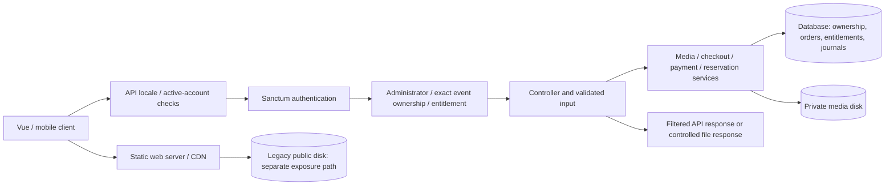

# Scemory security, media and marketplace audit

Review date: 20 October 2026. Scope: the current Laravel/Vue/Vite repository, including the previous `footer-legal-implementation.md` report. This is a source review with isolated local reproductions and implemented fixes, not a penetration test of production infrastructure. No production deployment, production migration, live payment, real-user notification, financial reconciliation or legal-policy approval was performed.

## 1. Executive summary

Confirmed problems included a shared password assigned to Google-created accounts, reactivation of suspended Google accounts, event/media authorization failures, event mass assignment, inconsistent wallet withdrawal reservations, unpaid paid-plan activation, exposed paid originals on public storage, and unsafe map popup HTML. Focused fixes and regression tests are included.

New event media originals, temporary event uploads, generated previews and AI video frames now use a separate local disk outside the webroot. Public published previews use a controlled route. Downloads check the active account and exact media entitlement, seller ownership or administrator role. Published free content remains viewable; logos, gift artwork, category/country artwork and existing public display assets retain their public roles. This does not make legacy public files private: **previously published restricted originals remain exposed until the operator blocks every old static URL and completes the verified copy/reference migration.**

Existing payment verification, server-side price snapshots, entitlement uniqueness and financial idempotency were retained. Withdrawals now reserve decimal and integer balances together, adjust only their own reservation, retain financial records and journal movements. Legacy discrepancies and unjournaled withdrawals stop for reconciliation rather than receiving an invented balance correction.

Dependency scans initially reported 53 Composer advisories across 14 packages and 16 npm affected-package entries. Targeted Composer updates, compatible npm fixes, MapLibre 6.4.1 and Vitest 4.1.11 address these; the final registry scans report zero known advisories. An advisory match confirms an affected installed version, not proof of an exploitable Scemory endpoint. Scan results are date-specific and do not establish absence of vulnerabilities.

The changes are suitable for **staging validation with synthetic data**. They are not certified production-ready: legacy edge blocking, migration review, real MySQL concurrency, WebGL2/mobile maps, production TLS/CDN/headers, provider integration and retention/licensing decisions remain gates below.

## 2. Security architecture

The registered application route inventory contains 228 routes, including 225 API routes. The inventory was read from `artisan route:list --json --except-vendor`; route groups and their controller/service implementations were reviewed. This count is an inventory, not a claim that each route received a penetration test.



### Authentication and API boundaries

| Route family | Actual boundary and review result |
| --- | --- |
| `users/register`, registration OTP, login, reset | Public validated flows with route throttles; reset now has expiry, account-scoped attempt limits, transactional consumption and token revocation. |
| Google login/callback/mobile exchange | Socialite server-side identity; existing mobile state, single-use delivery and PKCE exchange retained. Shared-password creation and suspension bypass fixed. Web callback state/token transport still needs hardening as described below. |
| `users/profile`, wallet, downloads | Sanctum; active-account middleware also rejects already-issued tokens for disabled accounts. New logout revokes the current bearer token. |
| Administrator CRUD, contacts inbox, footer settings | Existing administrator middleware retained. It is not replaced by frontend role checks. Some legacy admin groups use the admin middleware without explicit Sanctum middleware; these can reject bearer-only administrator requests and require separate compatibility review, not weaker authorization. |
| Public event discovery, directories, markers, collections, comments | Publication checks; event-media output uses previews. Pending event details and comments are blocked. Warm event caches are invalidated on visibility changes; the single-event endpoint also checks current publication before using cache. |
| Creator/dashboard/media requests | Authenticate, then check the requested event or the media's actual parent event. Cache keys include the event identity. |
| Cart, checkout, status and wallet deposits | Authenticated owner context; server snapshots and locked finalization; status routes owner/type scoped. Explicit limits added to payment/deposit creation. |
| PayPal callbacks/webhooks | Public by necessity; browser success is not authority. Existing verified capture and signed webhook services decide fulfillment. |
| Public legal contact | Existing bounded submission, five/minute throttle and persisted inbox retained. Guest/non-admin inbox restrictions covered by existing tests. |
| AI tools and moderation callbacks | Authenticated, throttled tool endpoints; server-side provider credentials; existing n8n shared-secret callback middleware. |
| Public reports and geocoding | Existing public/throttled routes. They are not privileged moderation or financial actions. Abuse controls still need operational monitoring. |
| Legacy `/create/{id}` update/delete registrations | Existing routes target missing controller methods. They were not turned into new mutation endpoints during this audit. |

Bearer tokens remain in the existing web localStorage/native secure-storage implementation. Native OAuth remains PKCE bound. CSRF protection applies to the web/session stack; it does not make a stolen bearer token safe. No replacement authentication architecture or blanket email-verification restriction was introduced.

### Storage, payments and third parties

* `public` maps to `storage/app/public`, normally exposed through `public/storage`. Nginx/static delivery bypasses Laravel authorization entirely. No repository evidence proves a production CDN, private S3 origin or edge ACL is configured.
* New `media` maps to `storage/app/media-private`, has private visibility, and disables filesystem route serving. It must never be symlinked or aliased into the webroot. Existing `local`/S3 configuration is not repurposed.
* `MediaAccessService` centralizes publication, active owner/admin, entitlement, disk allowlist, path normalization and canonical-file containment. `DownloadController` no longer falls back to arbitrary `public_path()` files.
* Preview routes check current publication; unpublished owner/admin views and moderation use five-minute signed grants. Original moderation grants are server-issued for n8n, not included in normal public event JSON. These are bearer capabilities valid until expiry; they are not single-use downloads.
* `CheckoutCartSnapshot` chooses media and prices on the server. `PaymentFinancialValidator` checks completed capture state, currency, amount in minor units, order/custom/reference identifiers and configured merchant. `PayPalWebhookVerifier` validates signatures and allowlists certificate endpoints; webhook replay records and capture uniqueness remain in use. `PaymentFinalizer` locks and grants unique entitlements; `WalletLedgerService` records idempotent integer movements.
* OpenRouter receives event text and limited images/representative frames through server-side clients. n8n receives expiring review grants. Translation and Nominatim use server-configured endpoints; maps fetch public styles/tiles/geographic data. No real user material was submitted to a provider in this audit. Provider logging was narrowed where raw response bodies were retained.

The separate original/preview boundary and storage outside the webroot follow the [OWASP file upload guidance](https://cheatsheetseries.owasp.org/cheatsheets/File_Upload_Cheat_Sheet.html). Requested-object authorization follows the [OWASP IDOR guidance](https://cheatsheetseries.owasp.org/cheatsheets/Insecure_Direct_Object_Reference_Prevention_Cheat_Sheet.html).

## 3. Findings and evidence

All reproductions use disposable users, SQLite test databases and generated media. HTTP status/amount examples below are fixture observations, not instructions to probe a deployed site.

| ID | Severity | Component / root cause | Evidence and impact | Remediation, tests and limits |
| --- | --- | --- | --- | --- |
| SC-01 | **Critical** | Google-created users received a shared placeholder password. | Three Google tests failed before fixing: shared-password hash matched, disabled callback returned 200, legacy placeholder login returned 200. A known email could be sufficient for credential login. | Generate an unknown random password for new OAuth users; reject the legacy placeholder on both password login endpoints without modifying accounts. `GoogleAccountSecurityTest` passes. Existing potentially compromised sessions need operator review/revocation. |
| SC-02 | **Critical** | Ordinary withdrawal code changed decimal `amount` without `balance_minor`; updates and admin settlement did not consistently reserve the selected amount. | A fixture withdrawal left 10000 minor units available after reserving 10.00 from 100.00. A subsequent purchase could use already-reserved funds. | Locked integer/decimal reservation service, exact adjustment/settlement, movement journal, retained records. `AccessAndFinanceTest`, `SessionsAndReservationsTest`. No automatic legacy reconciliation. |
| SC-03 | **High** | Restricted originals shared the publicly served disk with previews. | A real local HTTP static server read the legacy fixture through a storage symlink independently of Laravel; the new private original returned HTTP 404 through the same static server. | Private new storage, filtered output, controlled delivery, verified migration planner. `MediaProtectionTest`. **Legacy copies still need origin/CDN blocking; controller tests alone do not close this finding.** |
| SC-04 | **High** | Event/media IDOR: middleware checked whether the actor owned any event; uploads, media deletion and creator details lacked requested-object ownership checks. | Before changes, the nine access/finance regressions all failed; unrelated owner/media actions returned 200 instead of 403. | Exact parent/event authorization before mutation or cached reads. `AccessAndFinanceTest`; existing creator/admin workflows retained. |
| SC-05 | **High** | Dashboard event update accepted the entire request. | Fixture update could change `user_id`, active/trending fields. | Whitelist editable fields and verify owner/admin. Regression asserts owner/publication/trending cannot be changed by the submitted extras. |
| SC-06 | **High** | Existing bearer tokens survived suspension checks; Google callback explicitly reactivated suspended users. | Disabled-token fixture reached protected download; suspended Google callback returned 200 before fix. | API active-account middleware and Google refusal without reactivation/token issuance. Google and access tests cover both paths. Public preview visibility is separate from account authentication. |
| SC-07 | **High** | Subscription endpoint activated paid plans without verified payment and repeated reward points. | Controller directly assigned paid licence and incremented points from authenticated browser requests. | Refuse paid plans at this endpoint; lock and deduplicate free-plan activation/reward. `SessionsAndReservationsTest`. A verified paid-plan fulfillment design is still required; no billing promise was invented. |
| SC-08 | **High** | Map popup interpolated user titles/URLs into HTML. | Controlled hostile title would create an HTML element; unsafe URL/attribute delimiters reached `setHTML`. | Escape text/attributes and allow HTTP(S) media URLs. Actual popup-builder and helper DOM tests in `security.test.js`. MapLibre attribution sanitizer advisory fixed separately by patched dependency. |
| SC-09 | **Medium** | Media-request validation was effectively unbounded; image/video decoders lacked common resource checks. | Spoofed image contents were accepted before fixes. New fixtures reject executable/SVG/malformed media, invalid video, oversized input and oversized image dimensions. | Actual finfo content check, image pixel/dimension budget, bounded ffprobe duration/pixels, processing timeouts and private staging. `UploadProcessingTest`, access tests. Codec support depends on installed GD/Imagick/FFmpeg; antivirus/content-rights review is not implemented. |
| SC-10 | **Medium** | Reset OTP had no expiry enforcement; logout did not revoke the server token. | Source token check lacked created-at expiration; browser logout only cleared local state. | Expiry, attempt limit, locked one-time reset consumption, token revocation and authenticated logout. Session tests cover expired/success/reused code and token deletion. Offline logout can still only clear the local token. |
| SC-11 | **Medium** | Pending-event detail/comments and stale publication representations could disclose draft content. | Pending fixture is now 404 through event/collection/preview/comments routes, including after warming the public event cache. | Publication filtering, visibility cache invalidation, fresh single-event check and comment/reply/reaction checks. Legacy static draft previews require the same edge migration as originals. |
| SC-12 | **Medium** | Controller-caught errors returned internal exception messages; deployment lacked explicit response/file-execution protections. | Existing catch paths serialized exception messages. | Generic localized API 5xx bodies in production, no-store authenticated/media responses, nosniff, same-origin framing and referrer policy; Nginx restricts PHP execution to index.php and denies dotfiles. Header regression verifies caught-error masking. TLS/CSP/HSTS/static headers remain infrastructure dependent. |
| SC-13 | Package severities vary up to **Critical** | Affected locked dependencies, including runtime map attribution XSS and developer tooling. | Registry audit: npm 16 affected-package entries and Composer 53 advisories/14 packages before updating. No package advisory was represented as a confirmed application exploit. | Seventeen targeted Composer updates without major framework changes; npm security fixes; MapLibre/Vitest upgrades. Final scans zero. Registry coverage, browser/device compatibility and future advisories remain limitations. |

The known MapLibre issue concerns untrusted attribution strings, separately from Scemory's popup builder. The maintainer identifies the fix in [MapLibre's advisory](https://github.com/maplibre/maplibre-gl-js/security/advisories/GHSA-jrc7-96c5-q579). The shared local module uses the [documented Vite worker setup](https://maplibre.org/maplibre-gl-js/docs/#installation); the [v6 migration requirements](https://github.com/maplibre/maplibre-gl-js/blob/main/docs/guides/v5-to-v6-migration-guide.md) include ESM and WebGL2. This device requirement must be assessed in staging.

## 4. Media access policy and implementation

| Media class | Guest / unrelated account | Owner or seller | Valid purchaser | Active administrator |
| --- | --- | --- | --- | --- |
| Published priced event image/video | Controlled watermarked/blurred preview only | Preview plus original download | Preview plus exact entitled original | Preview plus original |
| Published free event media | Public viewable rendition; no payment needed to view | Original download | Original if entitled, including existing free checkout | Original |
| Pending/unpublished event media | No public event/preview access | Expiring review preview and authenticated original | Existing entitlement still permits original; unpublishing does not invent a purchase revocation rule | Review and original |
| Temporary event uploads / AI video frames | No static access for new files | Processing only | No grant from these files | Operational access only |
| Published public artwork, gift icons, logos, country/category assets | Public assets remain public | Existing edit boundaries | No purchase needed | Existing management boundaries |
| Existing cover images / comment attachments / legacy ancillary files | Existing public-display behavior retained | Existing behavior | No new licence implied | Existing behavior |
| Legacy restricted original or unpublished derivative on public disk | **Still readable by an old static URL until edge blocking** | Authorized Laravel route also works | Authorized Laravel route also works | Authorized route works |

`full_url`, `preview_url`, `url` and `video` display keys remain compatible in event-media JSON, but carry preview URLs rather than protected original paths. Original/preview disk fields are removed from that serialization. Cart, collection, discovery, download listing and timeline consumers were adjusted; frontend URL helpers preserve controlled and signed API URLs. File paths remain internal to jobs/services.

Raw uploaded event-image/video bytes are copied unchanged into private storage, preserving archival metadata. Image previews use a separate JPEG rendition with metadata stripping and single-frame decoding. Original SHA-256 equality is tested for both new image and real video processing. This does not establish that every legacy/public ancillary asset has had metadata removed. A published free image's direct-ingest rendition remains clear; analysed marketplace previews retain the existing blur/watermark behavior. No new licensing category was introduced.

Known original/preview aliases, normalized aliases and symlinks pointing to the same original are denied as paid previews. Paths reject traversal, encoded/control characters, URLs and drive syntax; resolved files must remain inside the selected allowlisted disk. Authorized delivery has no public-path fallback. Entitlements have no expiry field in this schema; deletion/revocation is tested rather than inventing expiry semantics. Signed review grants expire after five minutes and may be reused until expiry. Already saved copies cannot be revoked by code.

Ancillary public uploads are not silently reclassified by the event-media migration. Existing public cover/comment files can still contain personal metadata or outlive an event's publication. Review their intended visibility, archival requirements and retention separately before any production reclassification; do not describe all Scemory uploads as private.

## 5. Marketplace and financial protection

Client-supplied prices, success flags and another user's order IDs do not authorize fulfillment. Existing tests cover invalid capture state/amount/currency/merchant, duplicate notifications and purchases, webhook signatures, capture replay, owner-scoped status, wallet checkout, seller credit, entitlements and gift refund/reversal behavior. Added tests cover wallet currency mismatch, decimal/minor disagreement, reservation adjustment, overdraft rejection, precision, selected settlement, cancellation replay and administrator transitions. The MySQL concurrency suite now also contains ordinary-media duplicate-finalization and competing-order overspend cases; it is opt-in and was not run in this environment.

Withdrawal cancellation retains the row and returns the existing response contract. A completed withdrawal cannot be refunded by repeating a reject/delete request. Processing/completion/cancellation transitions use the same locked service; legacy UI `approved`/`paid` values map to the existing completed state. Existing pending funds without a corresponding reservation journal are deliberately blocked for manual reconciliation. Two-decimal currency handling matches the existing minor-money service; this work does not add support for zero-/three-decimal currencies or currency conversion.

Ownership of an event/media record, seller authorization, purchased download entitlement and copyright ownership remain different concepts. No copyright transfer or blanket commercial licence is created. Ordinary-media PayPal refund/reversal handling still records a manual-policy case rather than automatically revoking rights or crediting an invented refund. Gift-specific reversals are separate. Operator and legal review must define ordinary-media refund, dispute, seller earnings and entitlement rules before implementing them.

## 6. Changes implemented

The file-by-file inventory follows in the appendix. The principal changes are:

* Exact event access and active accounts; whitelisted event updates; owner-scoped creator/media cache access.
* Dedicated private event-media disk; preserved originals; private bounded processing; controlled previews/downloads and filtered API/consumer URLs.
* Additive disk-reference columns and a financial reservation journal; transactional withdrawal service; currency/projection checks during payment finalization.
* Expiring/resettable authentication flows, server logout, Google account hardening and limited expensive/payment routes.
* Safe map popup HTML, patched bundled map module/worker, removal of duplicate/unversioned MapLibre CDN loading.
* Thirteen complete security translation maps in the existing locale JSON files. Backend `SecurityMessage` reads those same files; there is no second translation catalogue. RTL routing/layout remains unchanged for Arabic, Persian and Urdu.
* Production error masking/headers, explicit bearer-friendly CORS configuration, production secure-cookie default, narrower Nginx execution and targeted dependency lock updates.

## 7. Validation

The local environment used PHP 8.3.6, SQLite in-memory databases, GD, FFmpeg/ffprobe 6.1.1, Node 22.14.0 and fake mail/storage/provider responses. The repository container targets PHP 8.2; its actual image and Imagick/HEIC/AVIF behavior still need staging validation. New media test storage is faked globally and unexpected Laravel HTTP provider calls are blocked.

| Check | Result |
| --- | --- |
| Full Laravel/PHPUnit suite | 301 tests: **292 passed, 9 skipped, 0 failures/errors**, 2051 assertions. |
| Frontend Vitest suite | **117 passed** in 16 test files using Vitest 4.1.11, including the actual popup builder. |
| Production web build | Passed; existing large-chunk warning remains. |
| Mobile production build | Passed. This is a build, not an Android-device test. |
| PHP syntax / Laravel Pint | Changed PHP files checked/formatted; final result below. |
| Composer audit / platform requirements | Zero advisories after updates; local platform requirements passed. |
| npm audit | Zero vulnerabilities after updates, including development dependencies. |
| Production filesystem/edge/CDN and live payments | Not exercised. |

Baseline classification is separate: an archive of the original HEAD was extracted into `/tmp/scemory-security/baseline-current-head`, with an isolated autoloader and SQLite test environment. `EventAiTagsDispatchTest` reproduced **six Intervention GeometryException errors and one passing case**, caused by scaling a 1-pixel fixture watermark to zero width. The minimum watermark dimension fix addresses that pre-existing processing defect. The updated seven-case dispatch suite now passes and asserts private storage. Old raw-preview/public-storage expectations were updated to the new delivery contract, not removed. Empty fake MP4 files were replaced with an actual generated one-second video; real FFmpeg processing is tested.

The nine original access/finance reproductions failed before fixes and passed afterward. The three Google account reproductions also failed before their fix and passed afterward. Static media access is separately tested using a real local HTTP server and public symlink. This evidence does not verify a production reverse proxy or CDN.

The skipped cases are seven opt-in gift/media MySQL concurrency cases and two weekly-competition MySQL concurrency cases. Docker's WSL integration/server was unavailable. SQLite request tests do not substitute for those row-lock/concurrency checks. Run the existing disposable `tests/run-gifts-mysql-concurrency.sh` and `tests/run-weekly-mysql-concurrency.sh` harnesses in a suitable isolated environment; never target the production database.

## 8. Production migration and rollback procedure — not executed

### Preparation and inventory

1. Obtain operational approval, maintenance/rollback ownership, verified backups of the database and both storage roots, expected capacity and an offline restore test. Review the additive migration on the target MySQL version. This repository has historical media table-name inconsistencies; confirm the deployed table is `events_images` before applying anything.
2. Deploy the additive schema and code to synthetic staging first. For a production change window, pause uploads, moderation/publication and price changes while taking the inventory/cutover snapshot; coordinate queue workers and in-flight old jobs. Do not roll old public-writing workers back into service while uploads continue.
3. Run the planner **only after approval on the intended environment**. Inventory mode does not copy/delete/change references:

   ```sh
   php artisan media:security-plan --output=review-20261020.json
   ```

   The manifest and companion Nginx-map entries are written under `storage/app/security-audit` with restrictive permissions. Names must be new basenames; files are not overwritten. Review every failed/manual row. The planner selects only restricted legacy event-media originals, using publication and price, and includes unpublished preview paths in the block list. It refuses known shared paths that would also block deliberately public free media/previews. Absolute URLs, unusual aliases, orphan files, ancillary assets, normalized/shared-path edge cases and external copies require manual inventory; a plan is not proof that all production aliases were discovered.

### Block old paths and copy safely

4. Adapt the generated exact URI entries for **every origin and alias**. An Nginx integration pattern is:

   ```nginx
   # http context, outside server {}
   map $uri $scemory_legacy_restricted {
       default 0;
       include /etc/nginx/scemory-restricted-media.map;
   }
   # In every server/alias that can serve these files:
   # if ($scemory_legacy_restricted) { return 404; }
   ```

   Use the reviewed generated entries, not a guessed wildcard against all storage. Test the complete target config with `nginx -t` before a controlled reload. Confirm URI decoding, aliases, alternate hostnames, range requests and proxy cache keys. The repository's base Nginx hardening does **not** install this production-specific deny map automatically. Purge all CDN/proxy/browser/service-worker caches under operator control, disable cached protected responses, and prevent public object-storage/origin bypass. Previously cached client copies cannot be recalled.
5. Verify with controlled fixture requests at the external edge **and directly against the origin**: protected legacy original/draft paths must return 403/404, published distinct previews and intentionally public free assets must still work. Block-list files alone are not proof of enforcement.
6. Copy without deleting public sources:

   ```sh
   php artisan media:security-plan --copy --output=copy-20261020.json
   ```

   Originals and distinct previews are copied to per-media private destinations and SHA-256 checked. Original aliases get a generated derivative. Existing destination corruption fails closed rather than being silently overwritten. Original source bytes stay untouched. Inspect every row, available disk space, derivatives, permissions and backups. Rerun using a new manifest name; deterministic destinations support partial retries. Manifests grow with inventory size, so test memory/time on a representative inventory.
7. Only after blocking/purge verification, switch verified references with explicit acknowledgment:

   ```sh
   php artisan media:security-plan --copy --apply --acknowledge-edge-blocking --output=apply-20261020.json
   ```

   The acknowledgment is an operator assertion; the command cannot validate a remote CDN. Each row checks unchanged references under a database lock, updates disk/path references after integrity checks and invalidates event caches. Also invalidate reviewed application DTO caches (including cart, discovery and timeline representations) containing old URLs; do not indiscriminately flush financial locks/idempotency state during active processing. Partial failures retain per-row statuses and exit unsuccessfully. Reconcile them before reopening writes. Previously applied rows remain private and are not recopied by the legacy selection. Preserve manifests from every run.

### Verification and rollback

8. Test guest/owner/non-buyer/buyer/wrong-product/admin/suspended actors, unpublished content, expired signed URLs, old URLs, direct-origin access, metadata preservation, ranges/video seeking, normal event sharing, cart, free/paid checkout and purchases made before cutover. Test n8n reachability within the signed grant lifetime. Check `APP_URL`, TLS/proxy signing, clock synchronization and all worker filesystem mounts. Verify no symlink/alias exposes `media-private` or `security-audit`.
9. On failure, pause writes and keep edge blocks in place. Prefer rolling forward with preserved additive columns and private-aware delivery. Public source copies and each manifest's `before`/`after` values allow a reviewed per-row reference reversal: under locks, first verify current references exactly match the manifest's `after`, verify both source/destination checksums, restore the `before` fields, and invalidate event caches. Do not reverse rows edited subsequently. This is an operator-reviewed transactional restore, not a blanket SQL update. Authorized Laravel downloads can read a blocked public source internally; static blocking must remain until a separately approved visibility decision.
10. Do not execute a blanket storage move/delete, `migrate:fresh`, automatic schema rollback, balance reconciliation or cache-unblocking rollback. The additive migration's `down()` deliberately refuses rollback and preserves its migration record, columns and reservation history. A previous application binary may not understand new private rows: maintenance mode or a compatible patched binary is required. Dropping schema/audit history requires a separate reviewed backup/restore plan. No delete step is supplied for the preserved public sources.

## 9. Privacy, remaining risks and decisions

| Area | Actual lifecycle / remaining requirement |
| --- | --- |
| Account and profile data | Account/Google identity and editable profile fields are stored in users/profile tables. Public event/comment author responses select display fields; creator details are owner/admin scoped. Full personal-data export/account erasure is not implemented. |
| Contact/legal reports | Bounded public collection into the existing private administrator inbox; no automatic statutory takedown/counter-notice process. Retention, staff access, response schedules and abuse monitoring require ownership. |
| Event originals and metadata | New originals remain byte-preserved privately; original access is still permitted to authorized buyers/owners/admins and granted moderation services. Legacy event/ancillary public files and previously shared URLs need operational classification and blocking. Public cover/comment metadata is a residual privacy risk. |
| Orders, wallets and withdrawals | Financial history is retained. Legacy balances/reservations must be reconciled against actual transactions, not trusted or rewritten automatically. Account deletion can interact with foreign-key cascades; do not introduce destructive erasure before retention requirements are approved. |
| AI and translation | Provider routing, processing countries, contracts, retention, user notice and billing/queue limits need operator/legal confirmation. Prompt output is untrusted metadata and does not grant publication, admin or payment authority. No antivirus, universal prompt-injection prevention or provider privacy guarantee is claimed. |
| Google/web tokens | Previously issued tokens may already be compromised and need approved review/revocation. Web Google flow still uses stateless OAuth and puts the token in the frontend redirect query; history/log exposure and login-CSRF protection need a compatible state-bound, short-lived web exchange. The mobile PKCE flow remains stronger. Do not log bearer/signed URLs; rotate exposed credentials as appropriate. |
| Logs/backups | New logs favor identifiers/structure instead of raw provider bodies, but older controller logs may contain personal event details or internal paths. Access controls, redaction, rotation, deletion and backup lifetimes are operational requirements. |
| Production configuration | Set production debug off, correct HTTPS `APP_URL`/frontend/provider URLs, secure/HttpOnly cookies, explicit CORS origins where appropriate, correctly scoped trusted proxies and protected storage mounts. CORS defaults remain non-credentialed; do not combine wildcard origins with credentialed cookies. The checked-in Compose file explicitly runs local/debug services, and `entrypoint.sh`, targeted by the Dockerfile, is empty; use a reviewed deployment command/entrypoint before container staging. This pre-existing deployment problem was not represented as a verified production setup. Full Nginx configuration syntax/reload was not exercised locally. |
| Browser defense | Added nosniff/framing/referrer headers are not a complete CSP. Stage a report-only CSP inventory for Google, PayPal, maps, fonts, workers and existing inline content before enforcement. Apply HSTS only at the verified HTTPS edge; also configure static-file response headers there. Other existing CDN resources remain supply-chain dependencies. |
| Map/browser compatibility | MapLibre v6 is ESM/WebGL2; workers are built locally for web/mobile. Confirm real GPU/device support, map style/tiles, Arabic RTL plugin and country/create/fullscreen maps before deployment. WebGL1-only devices are a compatibility limitation of the patched major version. |
| Licensing / legal text | Entitlement is not copyright transfer. Paid-plan fulfillment and ordinary-media refunds/disputes remain business decisions. Legal texts retain their previous draft/null-approval status; no approval or publication was implied by these fixes. |

The legacy public-media exposure is an **open High operational finding** until externally verified. The web OAuth/token transport and ancillary public-asset privacy limitations are not marked fixed. No production compromise or absence of compromise was established by local testing.

## 10. Deployment readiness

Proceed to isolated staging after reviewing the change inventory, schema and lockfiles. Before a production approval decision, complete MySQL concurrency, PHP 8.2/container/Imagick format testing, real browser/mobile WebGL2/RTL tests, payment/provider staging tests, external edge/origin migration verification, legacy token/balance reconciliation decisions and the privacy/licensing reviews above. Maintain the existing design system, 13 locale set and legal draft status.

No production action is waiting on an implicit approval from this report. The code, tests and operational procedure are reviewable deliverables; production execution requires explicit operator authorization.

## Appendix: final validation and file inventory

Final verification: **292 PHP tests passed; 9 skipped; 117 frontend tests passed; web and mobile production builds passed**. PHP syntax and Pint checks passed on the changed PHP files; `git diff --check` passed. Both dependency audits reported zero known advisories. Build warnings concern existing large chunks; Composer also reports existing case-mismatched Newsletter model filenames during optimized autoload generation. Those unrelated model files were not rewritten. Tracked mobile build output was restored after validation; deployment artifacts must be built from the approved source/lockfiles.

The final authorization review additionally reproduced two route/body-shadowing cases: submitted `id`/`slug` redirected a mutation after route authorization. Both fixture tests failed before fixing; controllers now use the same authorized route event throughout. They are included in SC-04 and the final full-suite count.

Reproducible checks (use a disposable test environment and test-only application key):

```sh
php vendor/phpunit/phpunit/phpunit
npm test
npm run build
npm run build:mobile:production
composer audit --locked
composer check-platform-reqs
npm audit
# Run Pint and php -l on the changed PHP file list.
git diff --check
```

The temporary local evidence directory is `/tmp/scemory-security`; it contains before/after fixture logs, original-HEAD error reproduction, builds and registry scan outputs. It contains no exported real-user data or credentials and is not a deployment dependency. The PHP suite uses SQLite `:memory:` from phpunit.xml. The registry queries sent package metadata only; no paid AI/payment/provider operation was used.

| Changed file | Purpose |
| --- | --- |

| [`app/Console/Commands/PlanMediaProtection.php`](../app/Console/Commands/PlanMediaProtection.php) | Inventory, copy/checksum and guarded reference application; source preservation and edge-map manifest. |
| [`app/Http/Controllers/api/admin/EventAdminController.php`](../app/Http/Controllers/api/admin/EventAdminController.php) | Inspect administrator event-cover uploads with SafeMedia. |
| [`app/Http/Controllers/api/admin/EventImageController.php`](../app/Http/Controllers/api/admin/EventImageController.php) | Authorize actual media parent before deletion; private upload pipeline and validation. |
| [`app/Http/Controllers/api/admin/FooterController.php`](../app/Http/Controllers/api/admin/FooterController.php) | Validate raster logo uploads before existing administrator-only storage updates. |
| [`app/Http/Controllers/api/admin/WithdrawlController.php`](../app/Http/Controllers/api/admin/WithdrawlController.php) | Use journaled, locked administrator reservation transitions; preserve records and bounded metadata. |
| [`app/Http/Controllers/api/admin/auth/AdminAuthController.php`](../app/Http/Controllers/api/admin/auth/AdminAuthController.php) | Validate login, refuse disabled administrators and legacy placeholder credentials. |
| [`app/Http/Controllers/api/auth/AuthController.php`](../app/Http/Controllers/api/auth/AuthController.php) | Reset expiry/attempt/transaction safeguards; revoke tokens on password change/reset; add server logout. |
| [`app/Http/Controllers/api/auth/DownloadController.php`](../app/Http/Controllers/api/auth/DownloadController.php) | Use exact rights and contained disk reads; safe signed preview listing and no-store downloads. |
| [`app/Http/Controllers/api/auth/GoogleAuthController.php`](../app/Http/Controllers/api/auth/GoogleAuthController.php) | Random new-account credentials, suspension enforcement and safe callback diagnostics. |
| [`app/Http/Controllers/api/home/CartController.php`](../app/Http/Controllers/api/home/CartController.php) | Published-media sale check and preview-only media display fields. |
| [`app/Http/Controllers/api/home/CommentController.php`](../app/Http/Controllers/api/home/CommentController.php) | Bound upload processing; enforce parent publication for comments. |
| [`app/Http/Controllers/api/home/CommentInteractionController.php`](../app/Http/Controllers/api/home/CommentInteractionController.php) | Require published parent before comment reactions. |
| [`app/Http/Controllers/api/home/CommentReplyController.php`](../app/Http/Controllers/api/home/CommentReplyController.php) | Require published parent before replies. |
| [`app/Http/Controllers/api/home/EventController.php`](../app/Http/Controllers/api/home/EventController.php) | Fresh publication gate and projections sufficient for safe media serialization. |
| [`app/Http/Controllers/api/home/EventUserCreateController.php`](../app/Http/Controllers/api/home/EventUserCreateController.php) | Private temporary staging and private-aware queued jobs with content-based media classification. |
| [`app/Http/Controllers/api/home/IncomeController.php`](../app/Http/Controllers/api/home/IncomeController.php) | Block unverified paid activation and duplicate free reward. |
| [`app/Http/Controllers/api/home/MediaDeliveryController.php`](../app/Http/Controllers/api/home/MediaDeliveryController.php) | Controlled preview and expiring moderation-origin delivery; prevent original alias/symlink previews. |
| [`app/Http/Controllers/api/home/MediaValidationController.php`](../app/Http/Controllers/api/home/MediaValidationController.php) | Inspect media budgets before photo-quality decoding. |
| [`app/Http/Controllers/api/owner/CreatorController.php`](../app/Http/Controllers/api/owner/CreatorController.php) | Authorize requested creator detail before cached reads. |
| [`app/Http/Controllers/api/owner/UserWithdrawlController.php`](../app/Http/Controllers/api/owner/UserWithdrawlController.php) | Validate bounded withdrawal edits and delegate reservation/cancellation to locked service. |
| [`app/Http/Controllers/api/payment/CollectionController.php`](../app/Http/Controllers/api/payment/CollectionController.php) | Require published collections and serialize safe media previews. |
| [`app/Http/Controllers/api/userDshboard/MediaRequestController.php`](../app/Http/Controllers/api/userDshboard/MediaRequestController.php) | Event-specific authorization/cache keys and private ingestion. |
| [`app/Http/Controllers/api/userDshboard/UserDashboardController.php`](../app/Http/Controllers/api/userDshboard/UserDashboardController.php) | Owner authorization, input whitelist, bound media validation and route/body shadowing defense. |
| [`app/Http/Middleware/EnsureActiveAccount.php`](../app/Http/Middleware/EnsureActiveAccount.php) | Reject existing Sanctum credentials for disabled accounts. |
| [`app/Http/Middleware/OwnEvent.php`](../app/Http/Middleware/OwnEvent.php) | Authorize the requested event rather than any owned event. |
| [`app/Http/Middleware/SecurityResponseHeaders.php`](../app/Http/Middleware/SecurityResponseHeaders.php) | Production API error masking, nosniff/framing/referrer headers and private cache policy. |
| [`app/Http/Requests/BrandRequest.php`](../app/Http/Requests/BrandRequest.php) | Add actual media-content/resource inspection and bounded fields using existing request validation. |
| [`app/Http/Requests/CommentRequest.php`](../app/Http/Requests/CommentRequest.php) | Add actual media-content/resource inspection and bounded fields using existing request validation. |
| [`app/Http/Requests/CountriesRequest.php`](../app/Http/Requests/CountriesRequest.php) | Add actual media-content/resource inspection and bounded fields using existing request validation. |
| [`app/Http/Requests/EventsMediaRequest.php`](../app/Http/Requests/EventsMediaRequest.php) | Add actual media-content/resource inspection and bounded fields using existing request validation. |
| [`app/Http/Requests/EventsRequest.php`](../app/Http/Requests/EventsRequest.php) | Add actual media-content/resource inspection and bounded fields using existing request validation. |
| [`app/Http/Requests/GenerateImageTagsRequest.php`](../app/Http/Requests/GenerateImageTagsRequest.php) | Add actual media-content/resource inspection and bounded fields using existing request validation. |
| [`app/Http/Requests/UploadMediaRequest.php`](../app/Http/Requests/UploadMediaRequest.php) | Add actual media-content/resource inspection and bounded fields using existing request validation. |
| [`app/Http/Requests/categoreyRequest.php`](../app/Http/Requests/categoreyRequest.php) | Add actual media-content/resource inspection and bounded fields using existing request validation. |
| [`app/Http/Resources/ProfileTimeline/TimelineEventResource.php`](../app/Http/Resources/ProfileTimeline/TimelineEventResource.php) | Use signed controlled cover-media previews in owned timelines. |
| [`app/Http/Resources/ProfileTimeline/TimelineEventSummaryResource.php`](../app/Http/Resources/ProfileTimeline/TimelineEventSummaryResource.php) | Use controlled cover-media preview in timeline summaries. |
| [`app/Jobs/GenerateEventAiTagsJob.php`](../app/Jobs/GenerateEventAiTagsJob.php) | Resolve original disk and private frame descriptors for AI processing. |
| [`app/Jobs/ProcessEventImageJob.php`](../app/Jobs/ProcessEventImageJob.php) | Preserve raw originals privately; deterministic retry target and separate stripped preview. |
| [`app/Jobs/ProcessEventVideoJob.php`](../app/Jobs/ProcessEventVideoJob.php) | Private original/preview, preserved retry source and bounded FFmpeg process. |
| [`app/Models/EventsImges.php`](../app/Models/EventsImges.php) | Preserve display fields while removing original paths and disk metadata from API arrays. |
| [`app/Observers/AdminDashboardStatsObserver.php`](../app/Observers/AdminDashboardStatsObserver.php) | Invalidate event representations when publication/media visibility or storage references change. |
| [`app/Repositories/Eloquent/Events/EventRepository.php`](../app/Repositories/Eloquent/Events/EventRepository.php) | Filter published detail and use preview service/projections for discovery consumers. |
| [`app/Rules/SafeMedia.php`](../app/Rules/SafeMedia.php) | Actual MIME, pixel/dimension and video-duration inspection with bounded probe. |
| [`app/Services/EventMediaIngest.php`](../app/Services/EventMediaIngest.php) | Shared existing-entry-point ingestion into private original/preview storage. |
| [`app/Services/EventModeration/EventModerationPayloadBuilder.php`](../app/Services/EventModeration/EventModerationPayloadBuilder.php) | Issue expiring server review grants instead of public original paths. |
| [`app/Services/GenerateImageTagsService.php`](../app/Services/GenerateImageTagsService.php) | Remove raw provider-body/content logging; retain structural diagnostics. |
| [`app/Services/ImageAnalysisService.php`](../app/Services/ImageAnalysisService.php) | Validate before decoding and prevent zero-dimension watermark processing. |
| [`app/Services/ImageTags/ImageDataUrlFactory.php`](../app/Services/ImageTags/ImageDataUrlFactory.php) | Allowlisted private/public stored-image descriptors with normalized paths. |
| [`app/Services/MediaAccessService.php`](../app/Services/MediaAccessService.php) | Central publication/ownership/entitlement checks, safe preview URLs and canonical disk containment. |
| [`app/Services/PaymentFinalizer.php`](../app/Services/PaymentFinalizer.php) | Refuse wallet currency/projection mismatch rather than silently relabel balances. |
| [`app/Services/VideoFrameExtractor.php`](../app/Services/VideoFrameExtractor.php) | Private AI frames, original-disk containment and bounded local FFmpeg/ffprobe. |
| [`app/Services/WithdrawalReservationService.php`](../app/Services/WithdrawalReservationService.php) | Atomic reserve/adjust/settle with integer balances and immutable movement history. |
| [`app/Support/EventAccess.php`](../app/Support/EventAccess.php) | Reusable exact owner/administrator event authorization. |
| [`app/Support/SecurityMessage.php`](../app/Support/SecurityMessage.php) | Read security messages from the canonical existing locale JSON files. |
| [`bootstrap/app.php`](../bootstrap/app.php) | Register global security headers and API active-account middleware. |
| [`composer.lock`](../composer.lock) | Targeted security updates to seventeen existing packages; no new direct dependencies. |
| [`config/cors.php`](../config/cors.php) | Complete explicit non-credentialed bearer-client CORS options and configurable origins. |
| [`config/filesystems.php`](../config/filesystems.php) | Add unserved private event-media disk outside public storage. |
| [`config/media_security.php`](../config/media_security.php) | Declare processing pixel/dimension, video-duration and timeout budgets. |
| [`config/session.php`](../config/session.php) | Default secure session cookies on production environments. |
| [`database/factories/UserFactory.php`](../database/factories/UserFactory.php) | Make default fixtures active ordinary users to avoid random administrator authorization false positives. |
| [`database/migrations/2026_10_20_000001_add_media_storage_and_withdrawal_audit.php`](../database/migrations/2026_10_20_000001_add_media_storage_and_withdrawal_audit.php) | Add disk-reference columns and reservation audit table; refuse destructive automatic rollback. |
| [`docker/nginx/default.conf`](../docker/nginx/default.conf) | Only index.php reaches FPM; other PHP paths and dotfiles are denied. |
| [`docs/security-media-marketplace-audit.md`](../docs/security-media-marketplace-audit.md) | Architecture, evidence, access matrix, changes, results and operational/rollback gates. |
| [`package-lock.json`](../package-lock.json) | Reproducible patched frontend/tooling dependency graph. |
| [`package.json`](../package.json) | Pin fixed MapLibre/Vitest versions; retain the existing frontend architecture. |
| [`resources/js/components/layouts/Navbar.vue`](../resources/js/components/layouts/Navbar.vue) | Revoke the server token during the existing logout action. |
| [`resources/js/i18n/ar.json`](../resources/js/i18n/ar.json) | Complete localized security namespace in the existing ar catalogue. |
| [`resources/js/i18n/de.json`](../resources/js/i18n/de.json) | Complete localized security namespace in the existing de catalogue. |
| [`resources/js/i18n/en.json`](../resources/js/i18n/en.json) | Complete localized security namespace in the existing en catalogue. |
| [`resources/js/i18n/es.json`](../resources/js/i18n/es.json) | Complete localized security namespace in the existing es catalogue. |
| [`resources/js/i18n/fa.json`](../resources/js/i18n/fa.json) | Complete localized security namespace in the existing fa catalogue. |
| [`resources/js/i18n/fr.json`](../resources/js/i18n/fr.json) | Complete localized security namespace in the existing fr catalogue. |
| [`resources/js/i18n/hi.json`](../resources/js/i18n/hi.json) | Complete localized security namespace in the existing hi catalogue. |
| [`resources/js/i18n/it.json`](../resources/js/i18n/it.json) | Complete localized security namespace in the existing it catalogue. |
| [`resources/js/i18n/ja.json`](../resources/js/i18n/ja.json) | Complete localized security namespace in the existing ja catalogue. |
| [`resources/js/i18n/ru.json`](../resources/js/i18n/ru.json) | Complete localized security namespace in the existing ru catalogue. |
| [`resources/js/i18n/tr.json`](../resources/js/i18n/tr.json) | Complete localized security namespace in the existing tr catalogue. |
| [`resources/js/i18n/ur.json`](../resources/js/i18n/ur.json) | Complete localized security namespace in the existing ur catalogue. |
| [`resources/js/i18n/zh.json`](../resources/js/i18n/zh.json) | Complete localized security namespace in the existing zh catalogue. |
| [`resources/js/services/EventService/eventMedia.js`](../resources/js/services/EventService/eventMedia.js) | Preserve controlled API media URLs. |
| [`resources/js/services/EventService/eventSearchHelpers.js`](../resources/js/services/EventService/eventSearchHelpers.js) | Preserve controlled media URLs for mobile resolution. |
| [`resources/js/services/MapService/MapService.js`](../resources/js/services/MapService/MapService.js) | Escape actual popup text/attributes and use patched shared map module. |
| [`resources/js/services/mapLibre.js`](../resources/js/services/mapLibre.js) | Configure one patched local ESM map library and bundled worker. |
| [`resources/js/services/safeContent.js`](../resources/js/services/safeContent.js) | HTML escaping and HTTP(S)-only media URL helper. |
| [`resources/js/views/auth/GoggleCallback.vue`](../resources/js/views/auth/GoggleCallback.vue) | Localize the disabled-account callback error. |
| [`resources/js/views/home/country_data.vue`](../resources/js/views/home/country_data.vue) | Load the same patched bundled map library instead of a separate old CDN version. |
| [`resources/js/views/home/create_event.vue`](../resources/js/views/home/create_event.vue) | Consume the patched map module with correct ESM worker configuration. |
| [`resources/views/index.blade.php`](../resources/views/index.blade.php) | Remove duplicate/unversioned MapLibre and obsolete RTL CDN script loading. |
| [`routes/api.php`](../routes/api.php) | Controlled media/logout routes and authentication/payment/upload rate limits. |
| [`tests/Feature/Api/Auth/DownloadEntitlementsTest.php`](../tests/Feature/Api/Auth/DownloadEntitlementsTest.php) | Retain uniqueness/order coverage while checking signed preview contract. |
| [`tests/Feature/Api/Events/EventAiTagsDispatchTest.php`](../tests/Feature/Api/Events/EventAiTagsDispatchTest.php) | Assert successful processing writes private original/preview files. |
| [`tests/Feature/Api/Events/EventCreationRequirementsTest.php`](../tests/Feature/Api/Events/EventCreationRequirementsTest.php) | Use genuine video bytes for required valid-upload cases. |
| [`tests/Feature/Api/Events/EventSearchFiltersTest.php`](../tests/Feature/Api/Events/EventSearchFiltersTest.php) | Verify discovery preview routing rather than raw original paths. |
| [`tests/Feature/Api/Payments/VirtualGiftConcurrencyTest.php`](../tests/Feature/Api/Payments/VirtualGiftConcurrencyTest.php) | Add opt-in ordinary-media duplicate-finalization and wallet-overspend concurrency cases. |
| [`tests/Feature/Jobs/GenerateEventAiTagsJobTest.php`](../tests/Feature/Jobs/GenerateEventAiTagsJobTest.php) | Use private frame fixtures matching the real extractor. |
| [`tests/Feature/Jobs/ProcessEventVideoJobTest.php`](../tests/Feature/Jobs/ProcessEventVideoJobTest.php) | Verify private retry copy and successful idempotent processing. |
| [`tests/Feature/Security/AccessAndFinanceTest.php`](../tests/Feature/Security/AccessAndFinanceTest.php) | Reproduce IDOR, mass assignment, body/route shadowing, account status, upload and wallet flaws. |
| [`tests/Feature/Security/GoogleAccountSecurityTest.php`](../tests/Feature/Security/GoogleAccountSecurityTest.php) | Reproduce shared credentials/suspension bypass and verify legacy credential denial. |
| [`tests/Feature/Security/MediaProtectionTest.php`](../tests/Feature/Security/MediaProtectionTest.php) | Actor matrix, static HTTP bypass, path/alias defense, visibility cache, migration corruption/apply/shared paths. |
| [`tests/Feature/Security/SessionsAndReservationsTest.php`](../tests/Feature/Security/SessionsAndReservationsTest.php) | Reset/logout/throttle, paid-plan/free-reward and reservation/production-header regressions. |
| [`tests/Feature/Security/UploadProcessingTest.php`](../tests/Feature/Security/UploadProcessingTest.php) | Malicious/malformed/bomb fixtures and real private video processing with checksum verification. |
| [`tests/Frontend/security.test.js`](../tests/Frontend/security.test.js) | Thirteen-locale completeness, actual popup DOM safety and controlled URL contracts. |
| [`tests/Support/MediaFixture.php`](../tests/Support/MediaFixture.php) | Generate a small real video locally without external media/provider calls. |
| [`tests/TestCase.php`](../tests/TestCase.php) | Isolate new private disk and block unexpected provider HTTP requests. |
